# HashFrontier

**Hash table construction, collision resolution and reproducible benchmarks**  
**散列表构造、冲突处理与可复现基准研究**

[](https://github.com/ZJY-HSBL/HashFrontier/actions/workflows/ci.yml) · [Releases](https://github.com/ZJY-HSBL/HashFrontier/releases) · [Paper registry](papers/registry.csv)

## HF-Score v1.0 | 统一综合评价标准（v0.6.0）

**评分协议已实现并冻结基础公式，但目前没有合格的真实跨论文综合排名。** 先通过差分正确性和全部强制工作负载，再采用同硬件、同 seed、**同操作轨迹 SHA-256** 的配对测量；静态完美散列、GPU 和并发算法另设赛道。

| 统一指标（均越低越好） | 权重 |
|---|---:|
| 构造 ns/key | 15% |
| 成功查询 ns/op | 20% |
| 失败查询 ns/op | 15% |
| 插入 ns/op | 15% |
| 删除 ns/op | 10% |
| 单次更新延迟 P99（ns） | 10% |
| 完整内存 bytes/key | 15% |

HF-Score 首先以 `robin_hood` 为预注册参考，对七项测量取带权对数速度收益，在预注册场景间惩罚不均衡：`100 × exp(加权场景平均对数收益 − 0.25 × 场景对数收益标准差)`。基线得分 100；**分数不是正确率，也不以 100 为上限**。低于 30 个完整配对随机种子的结果只能标为探索性，权重与场景设置必须在实验前固定；完整指标缺失、算法崩溃、轨迹不一致时不予排名。

- [详细定义与数学公式](scoring/PROTOCOL.md) · [预注册 JSON](scoring/protocol-v1.0.json) · [评测程序](scoring/hf_score.py) · [历史数据完整性报告](results/v0.6.0-data-readiness.json)
- [只用于验证工具的人工合成示例（不是论文实验）](examples/hfscore/demo-score.json)

```bash
python3 -m unittest discover -s tests -p 'test_hf_score.py' -v
python3 scoring/hf_score.py --protocol examples/hfscore/demo-protocol.json \
  --observations examples/hfscore/demo-input.csv \
  --output /tmp/hfscore-demo.json --csv-output /tmp/hfscore-demo.csv
# 正式评分：将协议中的 hardware_id、scenario/seed 清单与输入 CSV
# 替换为完成过全部正确性测试的真实统一实验数据，再运行同一程序。
```

**重要：**以往 v0.1.0—v0.5.0 的数据尚未将插入、删除、单次更新纳秒 P99 与完整内存口径全部分离，更没有多篇论文共用的完整 30-seed 矩阵，不能拼接旧 CSV 虚构综合排名。下一步仍是**忠实复现 Zombie Hashing、TPHT 和 Bubble-up Cuckoo 并使用统一操作轨迹测试**。

## v0.8.0 | SODA 2025 Basic Bubble-up joins cross-paper comparison

The [SODA 2025 **Basic Bubble-up** §4 implementation](docs/BASIC-BUBBLE-UP.md) is an **independent reimplementation of the paper's warmup algorithm**, with a clearly labeled out-of-scope direct-erase extension. **It is not the advanced §5 algorithm** and cannot claim its strongest theoretical bounds. The new [v0.8.0 common-trace experiment](.github/workflows/cross-paper-v08.yml) is configured for 6 implementations across 3 papers, 70/85/95% loads × 10 paired seeds = **180 planned runs**, with identical binary operation traces, live-key correctness checks, and explicit failure rows. Actual completed observations belong to the GitHub Actions evidence and versioned Release, not to the planned count. This **exploratory** comparison is not a formal HF-Score: memory accounting is not yet comparable and the formal 30-seed threshold is unmet.

## 中文 | 研究目标

### v0.7.2 | 两篇高水平论文，首次真实同轨迹横向对照（45/45 完整）

**正式实验证据已核查：** [GitHub Actions 39888537155](https://github.com/ZJY-HSBL/HashFrontier/actions/runs/39888537155) 的作者核心代码运行，45/45 个预定算法实例完成且通过精确集合 oracle。9 个二进制轨迹文件逐一重新计算 SHA-256，与每一行原始 CSV 所记录的 SHA 一致；每个负载/种子对应的五个算法输入完全相同。**这是两个不同论文的首次统一数据实测，而非一个论文内部的对比。**

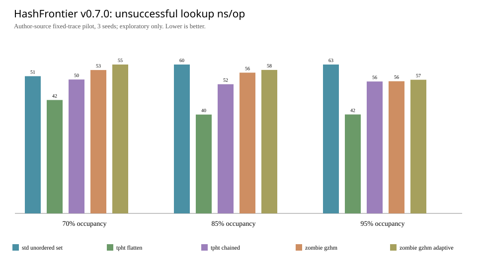

**95% 负载（8192 初始槽、7782 键、每种 3 个配对随机种子、32 churn 周期，平均 ns/op；越低越好）：**

| 来源/算法 | 构造 ns/key | 成功查询 | 失败查询 | 插入 | 删除 | 更新 P99 |
|---|---:|---:|---:|---:|---:|---:|
| PVLDB 2026 · TPHT Flattened | **45.65** | **46.16** | **42.11** | **47.32** | **50.08** | **90.67** |
| PVLDB 2026 · TPHT Chained | 60.90 | 60.71 | 56.14 | 71.74 | 77.29 | 127.33 |
| SIGMOD 2025 · Zombie GZHM | 252.20 | 63.64 | 56.23 | 667.33 | 74.49 | 2253.67 |
| SIGMOD 2025 · Zombie GZHM_ADAPTIVE | 126.87 | 64.18 | 56.86 | 561.07 | 73.28 | 1987.33 |
| C++ 标准库 · unordered_set | 84.67 | 63.03 | 63.36 | 69.25 | 82.70 | 130.33 |

**当前可证实的观察**：Flattened-TPHT 在这一特定工作负载下的查询与插入耗时更低；Chained-TPHT 的作者报告分配量为 87,092 字节，Flattened-TPHT 为 134,785 字节，表现出空间/速度取舍。GZHM_ADAPTIVE 在这个小规模长期插删测试中比 GZHM 的插入耗时更低，但这不能泛化到原论文的大规模工况。更新 P99 为各独立运行原始操作延迟的 nearest-rank 分位数**再取种子均值**，并非合并样本计算得到的全局 P99。

**严格限制**：本轮是 64-bit 集合成员语义，Zombie 原版配置为 0 位值、TPHT 使用 1 字节哑元值；各作者的内存统计方式不同，标准库的有效桶数也不同。单机 GitHub runner（AMD EPYC 7763）、仅 3 种子、时间测量包含每操作时钟调用开销，无法作正式显著性或跨硬件声明。**不得计算正式七项 HF-Score，也不得宣称已复现论文全部实验**。下一轮必须在统一 64-bit 键值语义和可比内存测量下补足 30 种子。

[原始 45 行 CSV](results/v0.7.1-cross-paper-observations.csv) · [45 次完成表](results/v0.7.1-cross-paper-completeness.csv) · [15 组汇总](results/v0.7.1-cross-paper-summary.csv) · [来源/参数核验](results/v0.7.1-cross-paper-provenance.json) · [CPU 编译环境](results/v0.7.1-cross-paper-environment.txt) · [两个作者原版代码 SHA-256](results/v0.7.1-cross-paper-author-sha256.txt) · [操作轨迹 SHA-256](results/v0.7.1-cross-paper-traces-sha256.txt)。完整二进制轨迹和逐次原始日志保存在 Actions Artifact，并在此版 Release 固化为可下载的压缩包。


### v0.7.1 | 作者源码跨论文实验修正

修正 ZombieHT 插入接口的返回码适配：非负值表示成功，而不仅是 0。原 v0.7.0 跨论文 workflow 已记录失败（小规模预检 unexpected zombie insert status=2），正式矩阵未执行；此后的有效数据只能来自 v0.7.1 新运行的 Artifact，不能用 v0.7.0 声称性能结论。

### v0.7.0 | 首次跨论文同轨迹实验（作者原版算法）

已添加 [跨论文统一二进制操作轨迹实验](papers/cross-paper-v0.7.0.md) 和 [GitHub Actions](.github/workflows/cross-paper-pilot.yml)。候选算法：SIGMOD 2025 原版 ZombieHT（GZHM、GZHM_ADAPTIVE）、PVLDB 2026 原版 TPHT（Flattened、Chained），以及标准库 set 对照。作者算法源码固定版本，不改动算法主体；所有算法必须逐项通过相同二进制输入和标准集合正确性检查。实验定义为**集合语义的先导交叉测试**，内存统计口径与正式 HF-Score/64-bit key-value 字典协议不同，因此**目前禁止生成正式 HF-Score 排名**。

先导矩阵：70/85/95% 负载，3 个配对随机种子，32 个 churn 周期；预计 45 次运行。完整、失败与未完成的原始证据由 Actions 和 Release 附件公开，不能把“工作流成功”直接当作“论文结果复现成功”。正式对比需要逐项核查输出结果。


通过 **2025-01-01—2026-10-22 高水平论文筛选 → 逐篇正确复现 → 统一负载评测 → 数据驱动机制设计 → 独立确认**，研究在构造耗时、成功/失败查询、动态插删、尾部延迟、空间开销之间具有稳健 Pareto 表现的散列表。核心方法优先不依赖机器学习。

收录范围限与散列表结构或冲突处理直接相关的 Nature / Science / Cell 体系、经年份及学科核实的 SCI Q1/Q2、以及 STOC / FOCS / SODA / SIGMOD / VLDB 等顶会。当前只有 **5 篇已核实的 2025 年论文候选**，并非穷尽检索；全部为 **queued（尚未复现）**。详见 [准入与验证协议](papers/PROTOCOL.md)。

**版本进度：v0.1.0 经典基线；v0.2.0 全表清理对照；v0.3.0 六独立种子 × 320 周期的精确更新尾部分析与有界修复的否定性结果。仍未完成任何顶会论文的论文级复现。**

### 已实现的经典基线

| Implementation | 构造/插入 | 删除 | 标记 |
|---|---|---|---|
| `linear_tombstone` | 线性探测 | 墓碑标记 | classic baseline |
| `linear_backshift` | 线性探测 | 后移补洞 | classic baseline |
| `robin_hood` | Robin Hood 交换 | 后移补洞 | classic baseline |

三者均使用相同的 SplitMix64 混合函数、固定的 2 的幂容量、同一批构建键及相同操作轨迹。它们是**独立工程实现，不代表任何新论文的精确复现**。

### v0.1.0 本地探索实验

固定容量 **4,096 个槽位**，目标负载 50%、80%、93%；每档使用 5 个配对随机种子，Uniform / Zipf(s=1.1) / hotspot-shift 三类访问分布，每种执行：建表、成功查询、失败查询、1,500 轮插删、插删后成功查询、插删后失败查询。每个查询阶段 8,000 次操作；每档设置都从新表开始。合计 **810 行原始观测**。

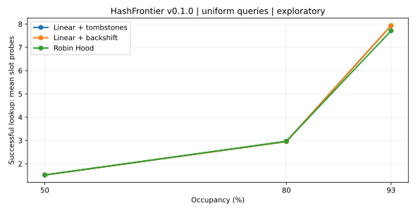

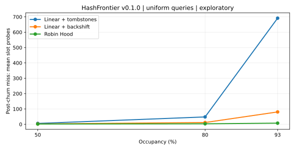

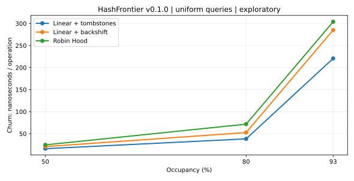

**代表性数据（Uniform，93% 负载，5 种子均值；探测次数越低越好）：**

| 基线 | 建表后成功查询探测/次 | 插删后失败查询探测/次 |
|---|---:|---:|
| Linear + tombstones | 7.93 | 691.45 |
| Linear + backshift | 7.93 | 80.63 |
| Robin Hood | 7.71 | 7.55 |

墓碑累积可能使长期未命中查询恶化；Robin Hood 的“按位移提前终止”有利于控制失败查询探测。然而 **Robin Hood 并非所有指标最好**：它的维护成本、额外 `home()` 计算和实际时间也必须考核。图表呈现的是这台本地容器的结果，不构成跨硬件的性能结论。

[完整原始 CSV](results/v0.1.0-local.csv) · [分组均值与标准差](results/v0.1.0-summary.csv) · [运行环境](results/v0.1.0-environment.json)

### 一键复现实验

```bash
cmake -S . -B build -DCMAKE_BUILD_TYPE=Release
cmake --build build -j
ctest --test-dir build --output-on-failure
./build/hf_benchmark 8000 5 > results/my-run.csv
python -m pip install matplotlib
python scripts/analyze.py results/my-run.csv --out figures
```

**测试要求**：正确性差分测试与 `std::unordered_set` 对照，4 档容量 × 6 种子 × 12,500 次操作 × 3 类实现 = 900,000 次随机操作；Release 编译下依然启用显式断言检查。所有记录由实际可运行代码生成。

**重要限制**：这是单进程 CPU 微基准；包含 8,000 次查询的较短时间片，时钟噪声较大。分组标准差仅描述跨 5 个种子的分散程度，不是置信区间。尚未控制 CPU 频率/NUMA、重复批次、内存分配器、分位延迟与多线程公平性；图表的时间数据不得用于正式论文的性能优越性声明。固定容量实验不包含动态扩容成本。 `allocated_bytes` 仅指槽位向量的底层容量，不包括容器头部/分配器/进程 RSS。多赛道（并发、GPU、静态完美散列）**不会直接放在一个不加限定的榜单**。

### v0.2.0 | 长周期插删与重建代价研究（已真实运行）

新增同容量 `linear_rebuild_2pct`、`linear_rebuild_8pct`、`linear_rebuild_half_slack` 三种 **全表墓碑清理对照机制**（**不是** SIGMOD ZombieHT），加上 v0.1.0 三个经典实现，共六个对照。12 个 churn 周期（每周期随机替换 5% 现存键）、75/85/95% 负载、5 个配对随机种子、每周期 256 次成功查询及 256 次失败查询、全部算法合计 1,080 条实验记录（6×3×5×12）。原始数据含更新对的 P99 与最大探测次数、重建次数、槽位搬移、计时指标。

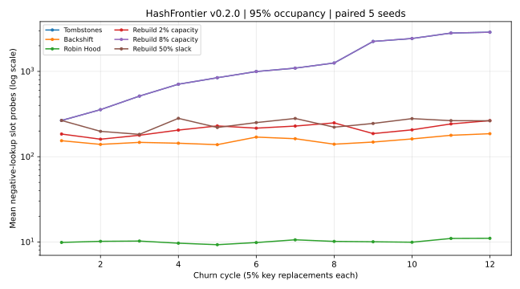

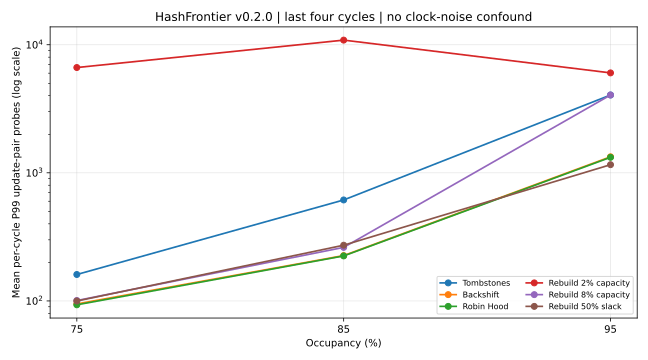

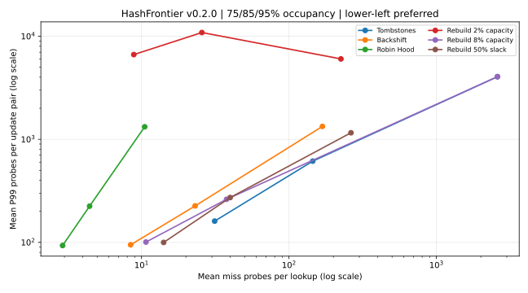

**95% 负载、末四周期（9–12）、每种算法先对每个随机种子求均值，再对五个种子平均：**

| 对照算法 | 失败查询均值（探测/次） | 周期内 P99 更新对探测均值 | 单周期最大更新对探测均值 | 平均每周期全表重建次数 |
|---|---:|---:|---:|---:|
| Linear + tombstones | 2,593.27 | 4,052.1 | 4,162.4 | 0 |
| Linear + backshift | 168.56 | 1,334.6 | 1,504.5 | 0 |
| Robin Hood | **10.51** | 1,321.95 | 1,463.1 | 0 |
| Global rebuild at 2% capacity | 225.00 | 6,028.3 | **39,031.3** | 1.15 |
| Global rebuild at 8% capacity | 2,593.27 | 4,052.1 | 4,162.4 | 0 |
| Global rebuild at 50% slack | 263.22 | **1,157.6** | 29,325.35 | 0.75 |

**关键发现：**95% 真实占用意味着最多只有约 5% 的槽位可为空槽或墓碑，因此“墓碑超过总容量 8% 才清理”在该负载下根本不可能触发。以空闲预算而非总容量为基准的阈值可以启动清理，但全表维护形成极大的最大探测开销；P99 则可能漏掉单个稀有的重建尖峰。Robin Hood 在这里的失败查询探测表现更好，但不能直接将其定义为跨场景最优；计时数据受缓存和时钟扰动，不用于论文显著性声明。

[原始 1,080 行 CSV](results/v0.2.0-churn.csv) · [按种子聚合的摘要、探索性区间](results/v0.2.0-churn-summary.csv) · [ZombieHT 作者实现及复现进度](papers/zombie2025/REPRODUCTION.md)

```bash
cmake --build build -j
ctest --test-dir build --output-on-failure
./build/hf_churn_benchmark 5 12 256 > results/v0.2.0-churn.csv
python scripts/analyze_churn.py
```

**研究状态：**已定位并审查作者公开仓库固定提交及原始构建/工作负载入口，并加入独立的作者代码编译与小型 smoke 工作流；这不是已经完成的原论文大规模复现。所有全表清理策略均属于经典对照，不冒充 Zombie Hashing。原论文实验需保留与本项目不同的 2²⁷ 槽设置、重复试验和具体硬件条件。

### v0.5.0 | 源码配对输入与 v0.4.0 实验故障审计

**此次首要研究结果是一项严格的失败审计，而不是对新算法的成功宣告。** [v0.4.0 作者原版多负载 CI](https://github.com/ZJY-HSBL/HashFrontier/actions/runs/39795819645) 在 95% 负载首次重复的 TRHM 中遭遇 SIGSEGV（139）；85% 下的四算法、两次重复均完成 320 周期。95% RHM 首次重复完成；TRHM 仅 191 周期，余下 **6 个任务没有执行**。完整性不能只由 GitHub CI 或作者 `main()` 退出值判断。

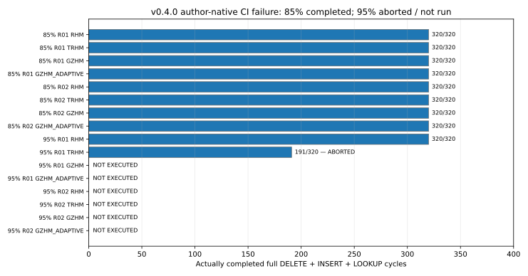

| 负载与批次 | RHM | TRHM | GZHM | GZHM_ADAPTIVE |
|---|---|---|---|---|
| 85% / R01 | 320/320 | 320/320 | 320/320 | 320/320 |
| 85% / R02 | 320/320 | 320/320 | 320/320 | 320/320 |
| 95% / R01 | 320/320 | **191/320，SIGSEGV** | 未运行 | 未运行 |
| 95% / R02 | 未运行 | 未运行 | 未运行 | 未运行 |

[原始证据](https://github.com/ZJY-HSBL/HashFrontier/actions/runs/39795819645) · [逐任务完成表](results/v0.5.0-v04-incident.csv) · [来源及校验](results/v0.5.0-v04-provenance.json)

新的 [**可配对作者源码工作流**](.github/workflows/zombie-paired.yml) 保持 `GZHM`/`GZHM_ADAPTIVE`/`TRHM`/`RHM` 算法实现原封不动，仅在上游 **benchmark 输入生成器**中接入可重复种子和操作流指纹：逐周期比较 BUILD/CHURN 操作数组的 hash；只有相同负载、相同种子、相同完整 320 周期的对象才能进入配对分析。另有输入漂移、原版提前终止与伪成功退出码的测试。工作流设定 85%/95% 负载、3 种种子以及 320 周期，并将在完成后产生 `completion.csv`、`trace-integrity.csv`、`complete-cohorts.csv`，未运行或中途崩溃的变体不允许进入排名。

**复现状态边界**：这是对作者程序的 *instrumented source* 对照实验，**不是** q=27 的全部论文实验，更不是我们的新算法。CI 若未成功完成，不能声称得到了配对优势结论。比较时间为作者实现的原生 `high_resolution_clock` tick/操作，跨进程 CPU 噪声仍有影响。后续应优先查明高负载 TRHM 崩溃原因、验证配对轨迹及 oracle 正确性，再推进创新方案。

### v0.4.0 | 论文原版实验的完成率审计（重要纠正）

SIGMOD 2025 [Zombie Hashing](https://doi.org/10.1145/3725424) 作者的固定源码版本 `5064a381fd3b7a540594fadd6f7595fdcc748a6c` 在 [GitHub Actions 原始运行记录](https://github.com/ZJY-HSBL/HashFrontier/actions/runs/39792045335) 中被成功编译并退出，但我重新获取**作者原始工作流 Artifact**（ID `12432115740`）后，发现 **TRHM 在 95% 负载的 q=13 缩小实验中只完成 194/320 个完整周期**，其余三个变体全部完成 320 个周期。早先笼统描述为“全部 320 周期成功”是不准确的，现已纠正。

| 作者原版变体 | 请求周期 | 完整周期 | 原始记录行数 | 审计结论 |
|---|---:|---:|---:|---|
| RHM | 320 | 320 | 960 | Complete |
| TRHM | 320 | **194** | **583** | **Incomplete** |
| GZHM | 320 | 320 | 960 | Complete |
| GZHM_ADAPTIVE | 320 | 320 | 960 | Complete |

原因追踪：作者 `bench/hm_churn.cc` 遇到 `QF_NO_SPACE` 时从 `profile_ops()` 返回失败，`run_churn()` 中止循环，而 `main()` 仍返回零。对于此次 TRHM 截断，仍需要额外的有日志重跑来确认准确的失败键和触发机制。因此这不是认定论文算法错误，而是**科研验证工具不能只相信进程退出码**的案例。

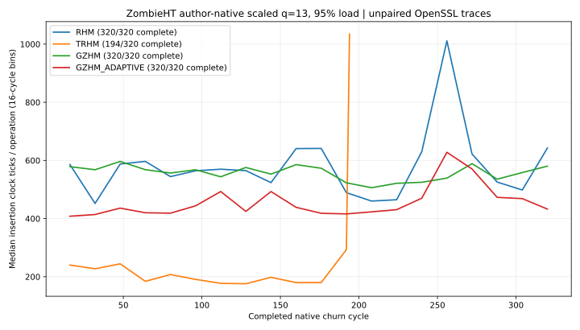

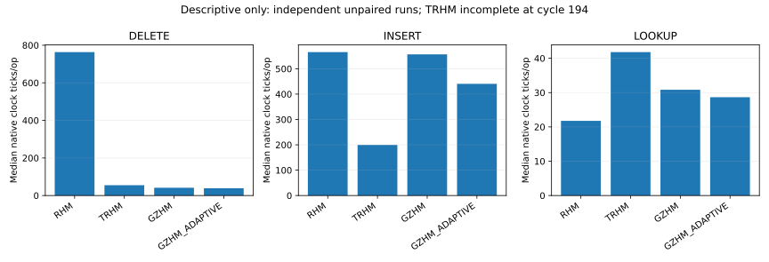

**原版缩小实验的描述性数据（每种方法自身完成周期的时钟 tick/操作，中位数）**：

| 原版实现 | DELETE | INSERT | LOOKUP |
|---|---:|---:|---:|
| RHM | 763.3 | 565.6 | 21.8 |
| TRHM（仅 194 周期） | 55.0 | 199.5 | 41.8 |
| GZHM | 41.3 | 556.7 | 30.8 |
| GZHM_ADAPTIVE | 38.9 | 440.5 | 28.7 |

不同实现使用作者内部 OpenSSL 随机数产生的**非配对数据**，不能据此做统计显著性或性能优越性的因果判断；TRHM 截断周期与其余方法不相同。原始时间字段是 `high_resolution_clock` 的 ticks，不保证跨硬件的纳秒单位。**本轮未运行作者论文 q=27 的完整原始大规模实验。**

[原作者源码 Artifact 与运行记录](https://github.com/ZJY-HSBL/HashFrontier/actions/runs/39792045335) · [完成性审计数据](results/v0.4.0-author-v03-audit/audit.csv) · [全部正常完成周期的原始解析数据](results/v0.4.0-author-v03-audit/native-cycles.csv) · [来源及 SHA-256](results/v0.4.0-author-v03-audit/provenance.json) · [审计工具与单测](scripts/audit_zombie_native.py)

**v0.4.0 还引入了作者原版 q=13 的 85%/95% 负载、每组 2 次独立重复、共 16 次运行的 Actions 工作流**；该工作流会强制验证周期完整性，并记录 TRHM 的提前终止。重复实验的实际完成情况以 [ZombieHT Actions 工作流](https://github.com/ZJY-HSBL/HashFrontier/actions/workflows/zombie-native.yml) 和对应 Artifact 为准，不应将尚未审核的运行当作结果。

下一步：用确定性的统一键/操作轨迹驱动**原论文作者实现本身**，而不是使用本地经典基线冒充；在此基础上补足相同初始装载、操作顺序、负载与硬件下的配对对照。再从稳定的失败模式设计墓碑分布不变量与有限重排机制。

### v0.3.0 | 320 周期实验：有界修复为什么失败？

本版加入两个**探索性算法假设** `bounded_repair_8` / `bounded_repair_32`：删除后只允许最多检查 8/32 个槽位，按线性探测合法路径搬移键；预算耗尽时保留墓碑。这些是我们自行设计的受限局部修复**对照**，**不是** Zombie Hashing 的实现，也不声称具有独创性。

所有 8 种算法在相同键、SplitMix64 散列、固定 4096 容量以及按种子配对的操作序列上测试：**75%/85%/95% 占用、6 个独立随机种子、每种条件 320 个 churn 周期、每周期替换 5% 现有键并查询 64 次命中与 64 次未命中**。总共 **46,080 条完整周期记录**，另外记录 144 个算法/负载/种子组的 **全量更新对探测直方图精确分位数**。与“每周期 P99 的平均值”不同，本版 P99 真正覆盖从第一个到最后一个周期的所有更新对。


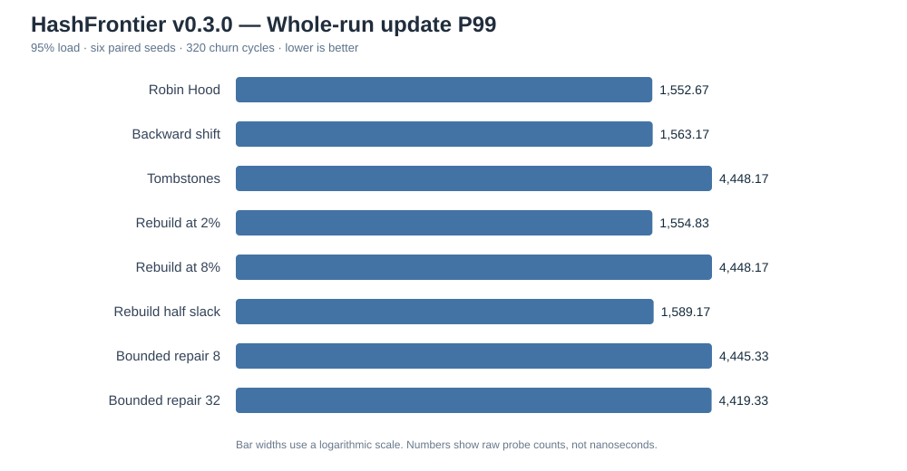


**95% 负载下的代表性结果**（每个种子先取末 64 周期均值，再跨种子求均值；更新 P99 是每个种子的**全 320 周期**真实分位数后取种子均值；探测次数越低越好）：

| 方法 | 末 64 周期失败查询均值 | 全局更新对 P99 探测均值 | 观察到的单次最大更新对探测 | 每种子平均全表重建次数 |
|---|---:|---:|---:|---:|
| Robin Hood | **10.34** | **1,552.7** | 4,245 | 0 |
| Backshift | 162.00 | 1,563.2 | 4,227 | 0 |
| Tombstones | 4,096.00 | 4,448.2 | 5,376 | 0 |
| Rebuild at 2% capacity | 216.34 | 1,554.8 | **107,188** | 365.5 |
| Rebuild at half slack | 234.62 | 1,589.2 | 105,272 | 250.7 |
| Bounded repair (8) | 4,096.00 | 4,445.3 | 5,309 | 0 |
| Bounded repair (32) | 4,096.00 | 4,419.3 | 5,426 | 0 |

**结论不是我们的新策略赢了：恰恰相反。** 有界 8/32 槽的修复仅延缓墓碑累积；长周期后几乎所有失败查询仍需扫描满表，原假设在这一测试中**被否定**。局部搬移预算本身不足以维持长期负载，需要额外的全局不变量或持续、可证明有效的墓碑再分布机制。固定 8% 容量的重建阈值在 95% 负载永远不会触发（与不重建版本表现一致）；而触发全表清理的策略出现十万级别的罕见更新探测尖峰，**更新 P99 未必能揭示这些峰值，因此同时报告最大值**。Robin Hood 在这组失败查询指标上最好，但在别的键类型/硬件/操作混合中未必整体最好。

[完整原始实验 CSV.gz（Release 附件，CI 独立重跑）](https://github.com/ZJY-HSBL/HashFrontier/releases/tag/v0.3.0) · [本地精确尾部 CSV](results/v0.3.0-tail.csv) · [种子层面汇总](results/v0.3.0-summary.csv) · [配对差值](results/v0.3.0-paired.csv) · [执行环境](results/v0.3.0-environment.json)

```bash
cmake -S . -B build -DCMAKE_BUILD_TYPE=Release
cmake --build build -j
ctest --test-dir build --output-on-failure
./build/hf_churn_benchmark 6 320 64 results/v0.3.0-tail.csv | gzip -9 > results/v0.3.0-churn.csv.gz
python -m pip install matplotlib
python scripts/analyze_v03.py
```

**作者原版 SIGMOD 2025 复现进度**：独立 GitHub Actions 从固定源提交编译 `RHM`、`TRHM`、`GZHM`、`GZHM_ADAPTIVE`，尝试 95% 负载的 320 周期缩小版原生实验（q=13、每周期 389 删/389 插/778 查），记录作者原始输出与机器、编译器信息。它不同于论文的 q=27 大规模实验，不与上述 HashFrontier 配对序列混入同一排行榜。作者实现的运行成功与否以 [Actions](https://github.com/ZJY-HSBL/HashFrontier/actions/workflows/zombie-native.yml) 实际结果为准；即使成功，也**不等于完成论文全文实验复现**。[审计记录](papers/zombie2025/REPRODUCTION.md)。

**限制：**目前仍是 64 次/周期的少量查询采样、固定整数键、单机微基准、6 种子探索性对比。原始时间字段包含计时成本，统计置信区间属于探索性估计；还没有 CPU 性能计数器、跨机器确认、动态扩容、更多 key 分布，以及原版作者算法与本地基线的严格配对对照。不能将这些结果视为顶会论文精确复现或新算法性能优越性的证据。

### 研究下一步

1. 对论文扩充检索并审计发表场所、实现/许可及复现实验规格；第一优先级是 **SIGMOD 2025 Zombie Hashing** 的窗口墓碑再分布，和 **SODA 2025 Bubble-up Cuckoo Hashing** 的高负载操作。
2. 在一致操作语义下复现原论文的实验设置，先重现单篇论文内部对比，再加入多算法交叉实验。
3. 将 **有界搬移预算 + 重排收益判断** 作为*待证伪的候选假设*，与已复现的顶会方法及经典基线比较；无显著收益则否定或修改，不预设创新成立。
4. 扩大到多数据规模、热点迁移、长周期 churn、失败查询比例、尾部延迟、内存预算及真实硬件计数器，最终在全新键集合/种子上独立确认。

### 主要已核实文献（2025）

- [Optimal Non-oblivious Open Addressing — STOC 2025](https://doi.org/10.1145/3717823.3718215)
- [Efficient d-ary Cuckoo Hashing at High Load Factors by Bubbling Up — SODA 2025](https://doi.org/10.1137/1.9781611978322.133)
- [History-Independent Concurrent Hash Tables — STOC 2025](https://doi.org/10.1145/3717823.3718283)
- [Zombie Hashing: Reanimating Tombstones in Graveyard — SIGMOD 2025](https://doi.org/10.1145/3725424)
- [GPH: An Efficient and Effective Perfect Hashing Scheme for GPU Architectures — SIGMOD 2025](https://doi.org/10.1145/3725406)

---

## English | Scope and evidence

### v0.7.2 actual cross-paper evidence (not a paper-level replication)

**45/45 complete and oracle-verified native runs** across three loads and three seeds; every algorithm consumed the exact same binary mutation/query trace within each load/seed group. The released raw CSV and source/trace SHA-256 manifests substantiate the results. The 95%-load per-operation ns averages are in the Chinese table and the chart above. Flattened-TPHT is faster in this small pilot, while Chained-TPHT uses less author-reported memory within the same codebase. This is not a formal HF-Score comparison: the set semantics, different dummy value widths, different allocation accounting, per-operation timing overhead and only three seeds are important limitations. The author implementations remain unmodified; benchmarking adapters are project code.

HashFrontier is a **reproducible benchmark-first research project** for hash table construction and collision handling. It aims to identify robust time/space tradeoffs across diverse workloads, rather than optimize only a single synthetic speed score. Prefer classical algorithmic and mathematical mechanisms over machine-learning-based controllers.

**Admission window:** 1 January 2025 through 22 October 2026. Only relevant high-tier conference papers and date/category-verified Q1/Q2 journals are eligible. The five-paper list is a **verified starter shortlist, not a complete systematic review**. All five entries are **queued**; no paper reproduction is claimed in this release.

**v0.1.0 provides** three independent classical baselines, differential tests, a uniform workload generator, 810 real exploratory local measurements, source CSVs, SVG figures, a manuscript admission protocol, and automated CI / release workflow.

Build and reproduce with the commands above. CPU microbenchmarks are environment-sensitive and are not publication-quality inference. Static perfect hashing, concurrent dictionaries, and GPU tables will be evaluated in separate capability-aware tracks. The performance objective is a Pareto tradeoff involving construction, positive/negative lookup, mutation, tail latency, and space usage; no single opaque score decides the winner.

**Reproduction integrity:** Paper implementations remain `queued` until validated against the relevant paper specification and its experiment protocol. Proposed improvements will have independent ablations, matched traces and seeds, and held-out confirmation.

License: [MIT](LICENSE).

### English | v0.2.0 update

Six independently implemented classical/control variants (three basic tables plus three periodic full-rebuild policies), 1,080 paired 75/85/95%-load churn records and 1.8 million randomized differential operations have now been evaluated locally. **None of the new controls implements Zombie Hashing.** Original SIGMOD 2025 code provenance is pinned in [the reproducibility plan](papers/zombie2025/REPRODUCTION.md), with a separate upstream smoke CI workflow. At 95% occupancy, a tombstone trigger set at 8% of capacity can never activate because total vacancies are only around 5%; a slack-relative trigger works but causes rare O(n) rebuild spikes. Per-cycle P99 alone may hide such extreme maintenance events, so the benchmark records maximum per-update probes as well. CPU timings remain exploratory; no claims of statistically significant speedups or exact author-paper reproduction are made.

### English | v0.3.0 update

We added two **exploratory bounded tombstone repair** controls (8/32 scanned slots on deletion), explicitly **not** Zombie Hashing or a novelty claim. The paired long-churn matrix contains 46,080 cycle records (8 algorithms × 3 occupancies × 6 independent seeds × 320 cycles), plus exact update-pair probe-tail histograms for 144 groups. At 95% load, both bounded-repair strategies degraded to 4,096 probes per unsuccessful lookup after prolonged churn, falsifying this initial heuristic. Full rebuild controls reduce misses but incur rare >100,000-probe maintenance outliers; reporting P99 without the maximum would hide this risk. Original SIGMOD 2025 authors' code is separately pinned and exercised via a **scaled 320-cycle native CI workflow**, not yet the full q=27 paper reproduction. See the [author provenance](papers/zombie2025/REPRODUCTION.md) and [v0.3.0 source/CI evidence](https://github.com/ZJY-HSBL/HashFrontier/releases/tag/v0.3.0). These are exploratory single-host results, not publication-ready superiority claims.

### English update | v0.4.0

Re-auditing the official SIGMOD 2025 ZombieHT q=13 author-output shows that the initial CI exit code falsely implied four complete 320-cycle runs: RHM, GZHM and GZHM_ADAPTIVE finished; TRHM stopped after 194 complete cycles plus a DELETE phase. The upstream binary returns 0 after an interrupted churn run. See [machine-readable audit](results/v0.4.0-author-v03-audit/audit.csv), [raw author artifact](https://github.com/ZJY-HSBL/HashFrontier/actions/runs/39792045335), [source provenance](results/v0.4.0-author-v03-audit/provenance.json), and [visuals](figures/v0.4.0-native-insert-trends.svg). This is a scaled, unpaired source-backed experiment, **not** faithful reproduction of the full SIGMOD paper and **not** evidence that our own hashing policy wins.

### English update | v0.5.0

We recovered a genuine CI failure in the v0.4.0 multi-load official-author experiment: both 85%-load repeats fully completed for all four variants, but the first 95%-load TRHM run segfaulted after 191 complete cycles; the remaining six high-load runs were not executed. This version records **missing vs incomplete vs complete** experiments explicitly. Our new source-instrumented paired-run workflow changes only the upstream benchmark input RNG and emits byte-stable per-cycle operation fingerprints; it does not replace or relabel the author hash table algorithms. Only complete and trace-identical cohorts may enter statistical comparison. Neither q=27 full-paper replication nor a superior new algorithm is claimed.
