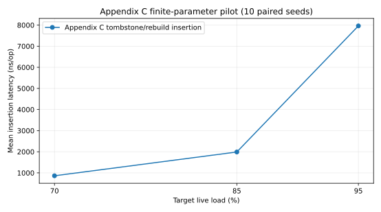
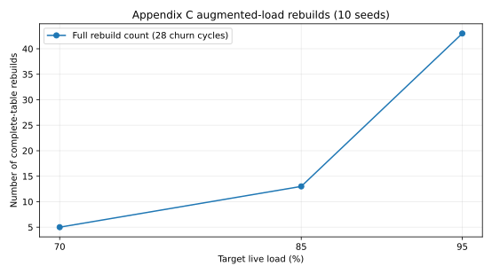

# SODA 2025 Bubble-up — Appendix C deletion reproduction audit

**Source:** Kuszmaul & Mitzenmacher, *Efficient d-ary Cuckoo Hashing at High Load Factors by Bubbling Up*, SODA 2025, DOI [10.1137/1.9781611978322.133](https://doi.org/10.1137/1.9781611978322.133), Appendix C pp. 27–28 (arXiv:2501.02312v1).

**Evidence tier: L1 mechanism / finite-parameter engineering verification, NOT L2 and NOT an L3 cross-paper comparison.**

## Appendix C algorithm mapping / 算法机制映射

1. `AdvancedBubbleUp::mark_deleted(key)`: a live key becomes a **physical tombstone**, without removing its slot or choice. Query excludes marked keys. A second erase fails.
2. Core and non-core insertion / eviction (`AdvancedBubbleUp::insert`): the tombstone payload and marker move together on **every** displacement; `tombstones_` tracks markers, while `count_` counts physical slots.
3. Reinsertion of a deleted key unmarks its original physical entry, preserving its existing hash-choice location.
4. `AdvancedBubbleAppendixC::insert`: when physical population approaches the fixed augmented-load threshold, rebuild a new table using only live keys and **discard all tombstones**, as described in Appendix C.
5. Insertion failure triggers the appendix's exceptional rehash path. A replacement is installed only if its reconstruction succeeds and passes the placement invariant; incomplete rebuilds never overwrite the working table.

## Finite implementation parameters and theorem limits

| Parameter | Pilot configuration |
|---|---|
| Capacity | 4,096 slots |
| Live occupancies | 70%, 85%, 95% |
| Hash choices | `d=10`, `d_core=5`, `alpha=0.5` |
| Augmented threshold | `load + 0.60*(1-load)` |
| Rebuild | Transactional, at most 4 deterministic rehash attempts |
| Randomness | SplitMix64-derived deterministic locations (NOT fully random functions) |
| Traces | 10 paired seeds, 28 churn cycles, replace 5% live keys per cycle |
| Correctness | Differential oracle + explicit duplicate/revival/delete cases, ASan and UBSan |

**Critical limitation:** Theorem 5.1 requires \(n^{-1/4}\le\epsilon\le e^{-d_{core}}\). With `n=4096`, `d_core=5`, `epsilon=0.05` at 95% load, `n^{-1/4}=0.125` and `exp(-5)=0.00674`, so **the admissible interval is empty**. Moreover `d=10` here is much higher than `ceil(log(1/0.05)+0.5)=4`, and this does not satisfy the theorem's optimal-hash-count premise. Therefore none of the paper's failure-probability or asymptotic complexity bounds are experimentally certified. No authors' full-scale figures have been reproduced.

**Parameter caution:** Appendix C introduces \(\epsilon'\) while describing the extra augmented-load slack; for the finite-size experiment we specify an explicit augmented threshold strictly *above* the target live load. Do not treat our pragmatic threshold or bounded seed retries as a proof of the paper's asymptotic constants.

**Scope caution:** These timings measure the independently engineered C++20 implementation, not original authors' optimized code. `bytes_per_key_impl_only` includes its live slot storage only; allocator bookkeeping, process RSS, and peak rebuild memory are **excluded**. These records are therefore ineligible for HF-Score.

## Real results / 真实测试结果

30/30 finite dynamic runs and the randomized property/differential test passed locally. There were 888 completed rebuilds in the 54 randomized correctness cohorts. The test also checks tombstones survive relocation, live cardinality matches the reference set, and resurrection is exact.

[Raw observations](../results/v0.9.1-appendix-c-pilot.csv) · [Summary by load](../results/v0.9.1-appendix-c-summary.csv)





Observed 95% live-load mean over ten seeds: **7,961 ns/insert**, **51.9 ns/delete**, **13,530 ns per-operation pooled update P99**, and **43 full rebuilds** for 28 cycles. Rare rebuilds make `max_update_ns` much larger than P99. These figures are local exploratory results, not an original-paper L2 replication. GitHub runner values must be separately reported rather than combined with local values.

## Re-run / 重复执行

```bash
c++ -std=c++20 -O2 -Iinclude tests/test_advanced_appendix_c.cpp -o /tmp/appendix-c-tests
/tmp/appendix-c-tests
c++ -std=c++20 -O3 -Iinclude src/appendix_c_benchmark.cpp -o /tmp/appendix-c-bench
/tmp/appendix-c-bench 10 28 > results/reproduction-appendix-c.csv
```

## Remaining L2 and L3

- Independent implementation review against **all** §5.2 and Appendix C pseudocode, including failed insertions and phase progression after rebuild.
- Specify constants that actually satisfy the theorem range using a sufficiently large `n` and `d_core` under its random-hash assumptions, or explicitly classify the theorem as analytically replicated only.
- Reproduce the authors' original large-scale experiment figures where available; theoretical-paper guarantees are not identical to small-scale benchmark outcomes.
- L3 is allowed only in a distinct, capability-compatible dynamic track with identical 64-bit key/value semantics, identical traces, 30 paired seeds, allocation instrumentation and complete HF-Score metrics.
