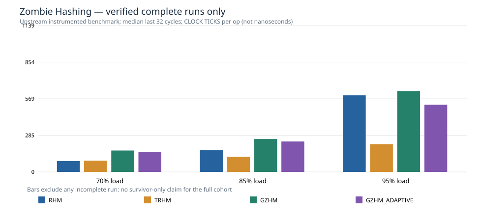

# SIGMOD 2025 Zombie Hashing — v0.12.0 source-native cloud pilot

> Real upstream algorithms at pinned commit 5064a381; benchmark input generation instrumented for identical paired traces; not unchanged author benchmark, not formal L3.

**Runs:** 36/36 complete; 0 failed/incomplete. Missing experiments remain in completion.csv.

**Hardware**: GitHub Actions ubuntu-24.04 ephemeral virtual runner; see [actual environment](../results/v0.12.0-zombie-native/environment.txt).

**Measured units:** author `clock_ticks_per_op`, not nanoseconds. Median of last 32 of 96 cycles, with complete runs only. Not valid as paper-original absolute ns latency.

| Load | Variant | Phase | Complete seeds | Median clock ticks/op |
|---:|---|---|---:|---:|
| 70% | RHM | DELETE | 3 | 92.94 |
| 70% | RHM | INSERT | 3 | 84.60 |
| 70% | RHM | LOOKUP | 3 | 24.06 |
| 70% | TRHM | DELETE | 3 | 55.78 |
| 70% | TRHM | INSERT | 3 | 87.10 |
| 70% | TRHM | LOOKUP | 3 | 40.94 |
| 70% | GZHM | DELETE | 3 | 52.42 |
| 70% | GZHM | INSERT | 3 | 166.25 |
| 70% | GZHM | LOOKUP | 3 | 37.12 |
| 70% | GZHM_ADAPTIVE | DELETE | 3 | 52.07 |
| 70% | GZHM_ADAPTIVE | INSERT | 3 | 153.66 |
| 70% | GZHM_ADAPTIVE | LOOKUP | 3 | 36.47 |
| 85% | RHM | DELETE | 3 | 235.80 |
| 85% | RHM | INSERT | 3 | 168.81 |
| 85% | RHM | LOOKUP | 3 | 25.13 |
| 85% | TRHM | DELETE | 3 | 55.44 |
| 85% | TRHM | INSERT | 3 | 117.43 |
| 85% | TRHM | LOOKUP | 3 | 40.64 |
| 85% | GZHM | DELETE | 3 | 51.62 |
| 85% | GZHM | INSERT | 3 | 255.49 |
| 85% | GZHM | LOOKUP | 3 | 36.93 |
| 85% | GZHM_ADAPTIVE | DELETE | 3 | 51.37 |
| 85% | GZHM_ADAPTIVE | INSERT | 3 | 236.58 |
| 85% | GZHM_ADAPTIVE | LOOKUP | 3 | 36.46 |
| 95% | RHM | DELETE | 3 | 998.73 |
| 95% | RHM | INSERT | 3 | 595.61 |
| 95% | RHM | LOOKUP | 3 | 27.42 |
| 95% | TRHM | DELETE | 3 | 62.78 |
| 95% | TRHM | INSERT | 3 | 215.91 |
| 95% | TRHM | LOOKUP | 3 | 44.68 |
| 95% | GZHM | DELETE | 3 | 53.17 |
| 95% | GZHM | INSERT | 3 | 629.12 |
| 95% | GZHM | LOOKUP | 3 | 37.87 |
| 95% | GZHM_ADAPTIVE | DELETE | 3 | 52.01 |
| 95% | GZHM_ADAPTIVE | INSERT | 3 | 522.55 |
| 95% | GZHM_ADAPTIVE | LOOKUP | 3 | 37.18 |

## Reproduction and evidence

- [All runs including failures](../results/v0.12.0-zombie-native/completion.csv)
- [Complete-run timing observations](../results/v0.12.0-zombie-native/native-complete-timings.csv)
- [Summary](../results/v0.12.0-zombie-native/summary.csv)
- [Verified exact operation fingerprints](../results/v0.12.0-zombie-native/trace-integrity.csv)
- [Upstream version, environment, SHA-256 and experiment protocol](../results/v0.12.0-zombie-native/provenance.json)

**Limits:** Reduced 8192-slot experiment, 3 paired seeds; key-only `-v 0`, hence no common 64-bit dictionary or HF-Score. A crash/nonzero exit/short phase log is marked incomplete, never treated as a successful measurement.

Run this workflow again to reproduce on another ephemeral VM; complete source-native logs are stored as a GitHub Actions artifact.
