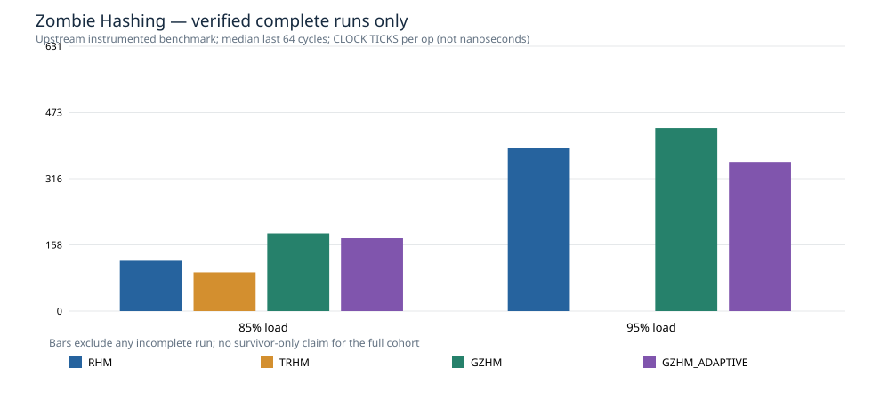

# Zombie Hashing SIGMOD 2025 — 320-cycle cloud long-churn replication

**Authors’ unchanged table implementations; only input generation fixed for reproducible paired operation traces.**

Real GitHub ubuntu-24.04 ephemeral cloud; pinned ZombieHT commit `5064a381fd3b7a540594fadd6f7595fdcc748a6c`. No physical-host ranking, no HF-Score.

**Completion:** 35/40 320-cycle workloads completed; 5 incomplete/failed. All attempts are retained.

| Load | Variant | Completed seeds/5 | Incomplete seeds |
|---:|---|---:|---|
| 85% | RHM | 5/5 | — |
| 85% | TRHM | 5/5 | — |
| 85% | GZHM | 5/5 | — |
| 85% | GZHM_ADAPTIVE | 5/5 | — |
| 95% | RHM | 5/5 | — |
| 95% | TRHM | 0/5 | 101 (161/320, exit 139), 102 (191/320, exit 139), 103 (131/320, exit 139), 104 (161/320, exit 139), 105 (161/320, exit 139) |
| 95% | GZHM | 5/5 | — |
| 95% | GZHM_ADAPTIVE | 5/5 | — |

## Native timing for complete runs only

**Author clock ticks/op, NOT ns.** Median of last 64 of 320 cycles within each seed; median across completed seeds. Do not infer full-cohort superiority when a variant has missing seeds.

| Load | Variant | Phase | Complete seeds | Median ticks/op |
|---:|---|---|---:|---:|
| 85% | RHM | DELETE | 5 | 162.33 |
| 85% | RHM | INSERT | 5 | 119.84 |
| 85% | RHM | LOOKUP | 5 | 17.63 |
| 85% | TRHM | DELETE | 5 | 42.16 |
| 85% | TRHM | INSERT | 5 | 92.22 |
| 85% | TRHM | LOOKUP | 5 | 32.02 |
| 85% | GZHM | DELETE | 5 | 34.15 |
| 85% | GZHM | INSERT | 5 | 185.28 |
| 85% | GZHM | LOOKUP | 5 | 24.79 |
| 85% | GZHM_ADAPTIVE | DELETE | 5 | 34.38 |
| 85% | GZHM_ADAPTIVE | INSERT | 5 | 173.64 |
| 85% | GZHM_ADAPTIVE | LOOKUP | 5 | 25.01 |
| 95% | RHM | DELETE | 5 | 553.60 |
| 95% | RHM | INSERT | 5 | 389.07 |
| 95% | RHM | LOOKUP | 5 | 18.91 |
| 95% | GZHM | DELETE | 5 | 33.78 |
| 95% | GZHM | INSERT | 5 | 436.13 |
| 95% | GZHM | LOOKUP | 5 | 25.26 |
| 95% | GZHM_ADAPTIVE | DELETE | 5 | 33.79 |
| 95% | GZHM_ADAPTIVE | INSERT | 5 | 355.46 |
| 95% | GZHM_ADAPTIVE | LOOKUP | 5 | 25.22 |

## Evidence

- [All 40 attempts including crashed/incomplete](../results/v0.12.1-zombie-long/completion.csv)
- [Native complete-run observations](../results/v0.12.1-zombie-long/native-complete-timings.csv)
- [Full source-native summary](../results/v0.12.1-zombie-long/summary.csv)
- [Exact operation fingerprint verification](../results/v0.12.1-zombie-long/trace-integrity.csv)
- [CPU/OS/compiler capture](../results/v0.12.1-zombie-long/environment.txt)
- [Provenance and failure counts](../results/v0.12.1-zombie-long/provenance.json)

These results test longevity and correctness of the author algorithms in a cloud pilot, not L3 memory-comparable 64/64-bit dictionary performance.
