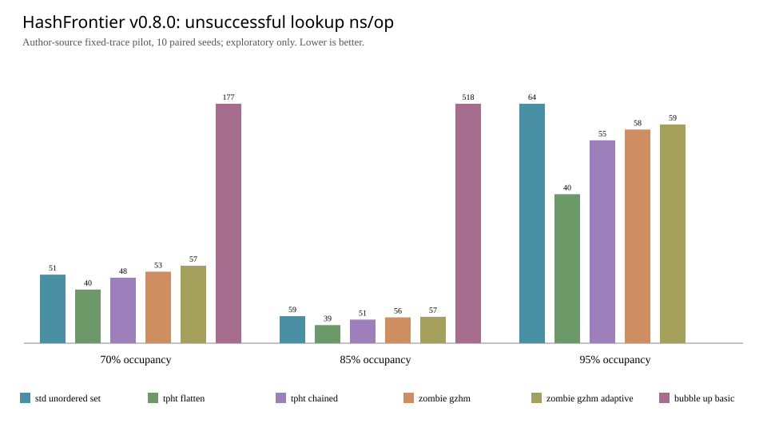
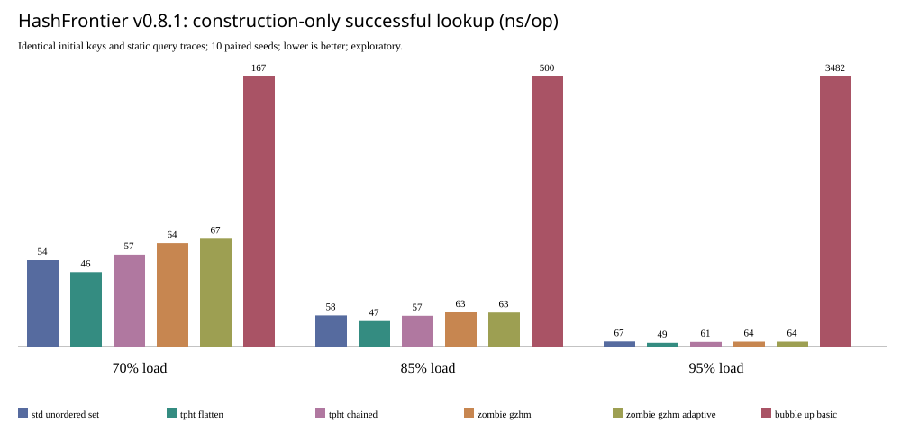

# Evidence-based results: HashFrontier v0.8.1

Source: [GitHub Actions run 39892858371](https://github.com/ZJY-HSBL/HashFrontier/actions/runs/39892858371), artifact ID `12474939871`. Author core code pinned to ZombieHT `5064a381fd3b7a540594fadd6f7595fdcc748a6c` and TPHT `3c39de26faba11bc1a037a1dfd24e3c633ac8987`; Basic Bubble-up is our §4 independent C++ reimplementation.

**Benchmark**: 8,192 slots, three target load factors (70/85/95%), ten paired seeds (`101..110`), identical recorded binary key/operation traces. Dynamic phase has 32 churn cycles (5% key changes per cycle) with 128 success and 128 miss queries per cycle. Static-only test replays identical initial keys and generates identical 4,096 hit/4,096 miss queries per seed without any deletion. Single GitHub runner CPU environment; observed clocks include per-operation measurement overhead.

## Full completion counts (no cherry-picking)

| Algorithm | Dynamic 70% | Dynamic 85% | Dynamic 95% | Static-only all loads |
|---|---:|---:|---:|---:|
| std::unordered_set | 10/10 | 10/10 | 10/10 | 30/30 |
| TPHT Flattened | 10/10 | 10/10 | 10/10 | 30/30 |
| TPHT Chained | 10/10 | 10/10 | 10/10 | 30/30 |
| Zombie GZHM | 10/10 | 10/10 | 10/10 | 30/30 |
| Zombie GZHM Adaptive | 10/10 | 10/10 | 10/10 | 30/30 |
| SODA Basic Bubble-up (direct-erase extension) | 10/10 | **3/10** | **0/10** | **30/30 insertion-only** |

The 17 failed dynamic runs returned `basic bubble-up core eviction limit`. Exact binary trace replay confirms several failures occur after successful initial construction and several completed churn cycles. This is not an empirical falsification of the SODA §4 theorem (which does not analyze our direct deletion extension), nor of the §5 advanced algorithm (not implemented).

## 95% load: dynamic timing (ns/op except ns/key construction)

| Method | Build ns/key | Hit ns/op | Miss ns/op | Insert ns/op | Delete ns/op | Update P99 ns |
|---|---:|---:|---:|---:|---:|---:|
| TPHT Flattened | 45.97 | 45.69 | 40.14 | 48.36 | 49.89 | 90.50 |
| TPHT Chained | 61.68 | 59.32 | 54.64 | 71.88 | 77.90 | 130.00 |
| Zombie GZHM | 252.06 | 64.92 | 57.53 | 647.41 | 74.11 | 1967.50 |
| Zombie GZHM Adaptive | 124.90 | 63.93 | 58.93 | 556.88 | 74.57 | 1831.20 |
| std::unordered_set | 86.36 | 59.94 | 64.48 | 70.42 | 81.65 | 131.20 |
| Basic Bubble-up + direct erase | **no complete runs** | — | — | — | — | — |

These are descriptive means of all ten completed seeds for each eligible method; no formal performance superiority claims follow from this pilot. The 95% load direct-delete Bubble-up version is NOT ranked from partial data.

## 95% load: static construction + lookup (no deletion)

| Method | Build ns/key | Hit ns/op | Miss ns/op |
|---|---:|---:|---:|
| TPHT Flattened | 49.97 | 48.92 | 38.86 |
| TPHT Chained | 62.39 | 60.63 | 50.70 |
| Zombie GZHM | 253.50 | 63.99 | 55.72 |
| Zombie GZHM Adaptive | 128.83 | 64.34 | 54.24 |
| std::unordered_set | 92.75 | 66.52 | 56.61 |
| **Basic Bubble-up (SODA §4)** | 4054.21 | 3481.74 | 3637.56 |

All 60 method×seed static measurements at 95% succeeded (including Basic Bubble-up). Basic Bubble-up's slow measured timings reflect the **particular naïve per-key hash-choice and duplicate-location rejection implementation**, as well as query probe order; they cannot establish that a better implementation of the paper's scheme must be this slow. Theorem 4.1 concerns expected **asymptotic insertion probes** under independent randomness, not a bound in CPU nanoseconds against TPHT.

## Limitations and next experiment

The core Blob/memory interfaces differ (TPHT 1-byte stored values, ZombieHT 0-byte payload, different capacity/memory accounting; STL lacks native allocator hooks). These differences prohibit formal **HF-Score** evaluation. To move toward a publishable comparison: unify value widths, report allocator-accounted peak and steady-state memory, collect 30+ paired seeds, normalize CPU core affinity and batch clock calibration, and implement SODA advanced §5 or its Appendix C deletion scheme before making claims about robust 95% dynamic workloads. No algorithm should be removed from the denominator when it fails.

Evidence: [dynamic observations](../results/v0.8.1-dynamic-observations.csv), [dynamic completion](../results/v0.8.1-dynamic-completeness.csv), [static observations](../results/v0.8.1-static-observations.csv), [static completion](../results/v0.8.1-static-completeness.csv), [seed paired timing-only ratios](../results/v0.8.1-paired-timing.csv), [SHA provenance](../results/v0.8.1-provenance.json).

