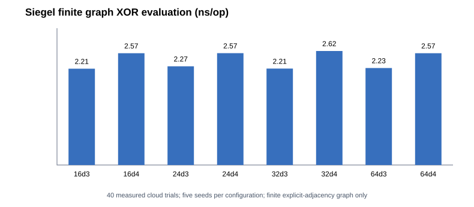
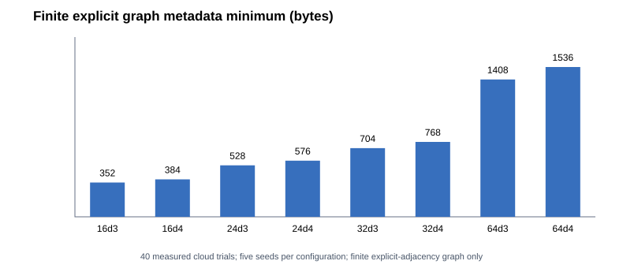

# Siegel 2004, Lemma 2.6 — exactly certified finite peelable-graph mechanism

**Classification: faithful reproduction of a mathematical subroutine and finite proof certificate, NOT a reproduction of Siegel's explicit asymptotic highly-independent hash family.**

Primary: Alan Siegel, *On Universal Classes of Extremely Random Constant-Time Hash Functions*, SIAM J. Computing 33(3), 2004, DOI 10.1137/S0097539701386216. Cross-check: Mikkel Thorup, *Simple Tabulation, Fast Expanders, Double Tabulation, and High Independence*, FOCS 2013, §I.B, referencing Siegel Lemma 2.6 (https://ieee-focs.org/FOCS-2013-Papers/5135a090.pdf). DMPP06 requires Siegel's high-independent **row shifts**; the present finite core tests a required mathematical dependency, not its large-universe implementation.

## Mechanism

A left vertex/key x has `degree` neighbors in a right-side table of independent uniformly random 64-bit words. Hash evaluation is the XOR of these random words. Every nonempty subset of at most k distinct keys is certified to have a **unique right neighbor** (appearing exactly once among the edges of that subset). This enables peeling and proves k-wise independence for independently sampled table words, conditional on the graph certificate. We enumerate **all** key subsets of sizes 1..k instead of estimating success probabilistically.

Negative case: a graph whose left vertices all access the same three right positions fails the unique-neighbor certificate, and an explicit bad subset witness is produced. Positive case: a tiny 5-left, 10-right, degree-2 graph passes the k=3 certificate; across every one of its 2^10 independent random-bit table assignments, the output distribution for *every* subset of 1, 2, or 3 keys is exactly uniform.

## Important limitations

- The graphs are drawn randomly, their **entire adjacency matrix is stored explicitly**, and only the finite k=4 condition is verified for 16/24/32/64 keys. This takes Ω(u·degree) graph memory. **Not Siegel's explicit constant-time neighbor generation nor his sublinear-storage construction.**
- The output table uses 64-bit `splitmix64` values for reproducible engineering trials. SplitMix is a pseudorandom generator: the strict k-wise theorem refers instead to **independently uniformly sampled** table words. Exact uniformity is verified only in a finite 1-bit table enumeration.
- Graph generation is an unbounded search conceptually; our implementation imposes 256 attempts. Existence at larger scales, efficient construction, high-probability success, and the full Siegel / DMPP06 independence guarantee **are not proved**.
- The finite graph is **not wired into DMPP06 quotient hashing** because doing so would silently change its space complexity and independence assumptions. Not a full DMPP06 or Partner Hashing reconstruction, and not eligible for HF-Score.

## Reproduce

```bash
c++ -std=c++20 -O2 -Iinclude tests/test_siegel_peelable_finite.cpp -o /tmp/siegel_test
/tmp/siegel_test
c++ -std=c++20 -O3 -Iinclude src/bench_siegel_peelable_finite.cpp -o /tmp/siegel_bench
/tmp/siegel_bench > /tmp/raw.csv
python3 scripts/report_siegel_finite_v025.py /tmp/raw.csv /tmp/summary
python3 -m unittest discover -s tests -p test_siegel_finite_report.py -v
```

Cloud protocol: {16,24,32,64} left keys × {3,4} distinct neighbors × 5 graph seeds, right-side size = 2u, k=4. Each entry certifies all nonempty key subsets sizes ≤4, then times 120,000 actual XOR evaluations. Records include exact enumerated-subset counts, successful graph-search attempts, minimum graph adjacency size (excluding vector overhead), random word-table bytes, checksums, timings, and machine identity. Cloud evidence is archived only after the job succeeds.

## Independently verified cloud results — v0.25.0

[GitHub Actions run 40848770409](https://github.com/ZJY-HSBL/HashFrontier/actions/runs/40848770409) succeeded: 40/40 observations, eight configurations × five seeds, 4,416,204 subsets certified in the C++ test, 130 exact tiny-graph joint-uniformity cells; ASan/UBSan and strict CSV regression tests passed.

Environment: AMD EPYC 9V74 (4 vCPUs), Ubuntu 24.04, GCC 13.3.0.

| Keys | Degree | Minimum graph bytes | 64-bit table bytes | Median ns/eval |
|---:|---:|---:|---:|---:|
| 16 | 3 | 96 | 256 | 2.21068 |
| 16 | 4 | 128 | 256 | 2.56703 |
| 24 | 3 | 144 | 384 | 2.26609 |
| 24 | 4 | 192 | 384 | 2.56720 |
| 32 | 3 | 192 | 512 | 2.21342 |
| 32 | 4 | 256 | 512 | 2.61744 |
| 64 | 3 | 384 | 1024 | 2.22687 |
| 64 | 4 | 512 | 1024 | 2.56612 |

**Measurement interpretation**: the graph byte count is only the raw unsigned 16-bit adjacency payload, not actual C++ container memory use; the 64-bit table is separate. The timing is the evaluation of a pre-generated fully stored graph, not the work required to generate it. No extrapolation to Siegel's asymptotic performance or space is justified.

[Raw CSV](../results/v0.25.0-siegel-finite/raw.csv) · [Statistics](../results/v0.25.0-siegel-finite/summary.csv) · [Audit](../results/v0.25.0-siegel-finite/audit.json) · [Provenance](../results/v0.25.0-siegel-finite/environment.txt) · [SHA-256](../results/v0.25.0-siegel-finite/sha256.txt)




