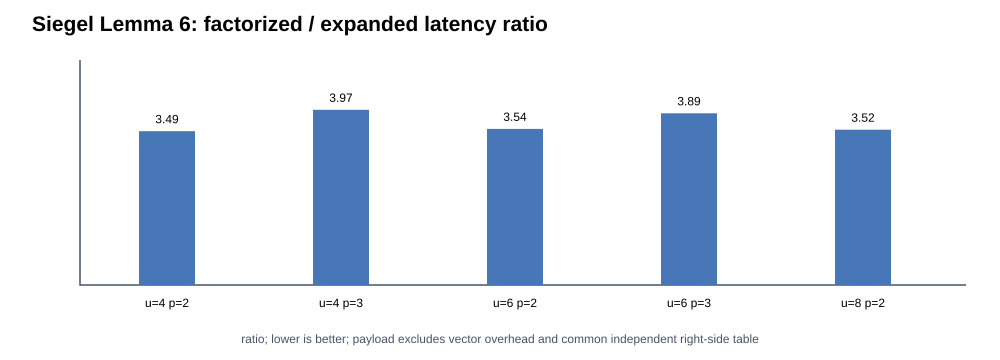
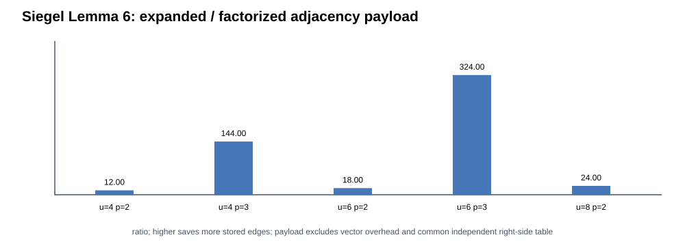

# Siegel 2004 Lemma 6 — finite tensor product of certified local graphs

**Paper**: Alan Siegel, *On Universal Classes of Extremely Random Constant-Time Hash Functions*, SIAM J. Computing 33(3), 2004. DOI: [10.1137/S0097539701386216](https://doi.org/10.1137/S0097539701386216). Original full text: https://cs.nyu.edu/~siegel/FASTH.pdf .

**Scope**: faithful **finite product-graph mechanism** corresponding to the paper's Lemma 6 / Section 2.2. This **does not reproduce** Siegel's entire constructive hash family, its asymptotic graph generation, or DMPP06/Partner Hashing.

## Mechanism

Take a base bipartite graph with `u` left keys, `v` right positions and constant degree `d`. Previous `v0.25.0` validates every nonempty subset of up to four base keys has a uniquely incident right neighbor (finite k-peelability). The present implementation composes its neighbor relation `p` times as a *tensor graph product*: the product left key `(x1,...,xp)` has exactly the Cartesian combinations of base right neighbors `(y1,...,yp)`. It computes this relation **on demand from the small base graph**, so that the product graph's `u^p * d^p` edge array need not be held persistently. `p` is 2 or 3 in these tests.

The encoded product-right address is `sum_{i=1..p} y_i * v^(p-i)`. It is **not** enough to XOR random words associated with the individual base neighbors. The product's `v^p` distinct right addresses must each have independent uniform random word values to invoke the mathematical theorem. The finite execution uses deterministically seeded SplitMix64 to provide reproducible pseudo-random values, and independently verifies a tiny product's exact two-key output distribution by exhaustive enumeration of **all** 2^9 right-table bit assignments. No exact independence theorem is inferred from SplitMix64.

Finite tensor graphs are **fully enumerated for certification**, using temporary expanded adjacency. The timed factorized evaluator does not store the expanded graph. The memory comparison quotes the theoretical edge **payload only**, not measured resident memory or standard-library vector overhead; this prototype's `SiegelFinitePeelable` also retains its *unused* original random base table, and the independently indexed product-right table is counted separately. Do not misrepresent the edge-payload difference as total memory savings.

## Verification and interpretation

- Every tested base graph is certified k=4. The product graph is independently tested for all nonempty subsets up to k=4 (power 2), k=3 (power 3, u=4), or k=2 (power 3, u=6).
- The product's k-peelability follows directly for these cases from the base graph's k-peelability; exhaustive tests are an additional finite cross-check, not an asymptotic proof.
- Every product key's on-demand neighbor list is checked for distinct, in-range positions; its XOR hash is compared to independently enumerated explicit adjacency using **the same** per-product-right-side table.
- The deterministic pseudo-random base graphs are found by bounded random search (as in v0.25.0), *not* Siegel's efficient asymptotic graph constructor. The full Siegel 2004 high-independence construction has large constants, and fast general on-demand neighbor generation with proven expansion is not established by this finite demonstration.
- Two timed methods: `factorized` recursively evaluates from the base graph; `expanded` uses an explicit `u^p*d^p` array. Each runs 150,000 identical input queries on the same random word array and the CSV auditor requires exact matching checksums.
- Experiment matrix: u=4/6/8, d=2/3, power=2/3 (omit u=8,power=3), five seeds: **50 paired configurations, 100 timed rows, 10 parameter groups**. All timing figures are for finite cases, not the paper's asymptotic complexity.

## Reproduction

```bash
c++ -std=c++20 -O2 -Wall -Wextra -Iinclude tests/test_siegel_tensor_product_finite.cpp -o /tmp/siegel-product-test
/tmp/siegel-product-test
c++ -std=c++20 -O3 -DNDEBUG -Wall -Wextra -Iinclude src/bench_siegel_tensor_product_finite.cpp -o /tmp/siegel-product-bench
/tmp/siegel-product-bench > /tmp/siegel-product.csv
python3 scripts/report_siegel_tensor_v026.py /tmp/siegel-product.csv /tmp/siegel-product-summary
python3 -m unittest discover -s tests -p test_siegel_tensor_report.py -v
```

The cloud workflow also runs ASan/UBSan, saves raw evidence and environment fingerprints, and commits results only after strict checks pass.

**Still outstanding**: Siegel's full large-universe explicit neighbor generator, word-RAM time/storage analysis, DMPP06 high-probability quotient hashing and its complete tertiary dictionary, STOC 2025 Partner Hashing. This finite Lemma-6 module must not enter formal HF-Score.

## Independent GitHub Actions verification for v0.26.0

[Cloud run 40850221365](https://github.com/ZJY-HSBL/HashFrontier/actions/runs/40850221365) completed successfully. AMD EPYC 7763 virtual CPU; Ubuntu 24.04; GCC 13.3.0. Exactly **100 observations, 50 checksum-identical matched pairs, 10 summary groups, five paired seeds**. The cloud certification across all pairs performed **8,155,270 finite subset checks**; the C++ deterministic randomized/full-domain test separately checks **4,893,162** subsets.

| u | d | power | Factorized edge payload (B) | Expanded edge payload (B) | Common product random table (B) | Factorized ns/op | Expanded ns/op |
|---:|---:|---:|---:|---:|---:|---:|---:|
| 4 | 3 | 2 | 24 | 288 | 512 | 23.0441 | 6.61105 |
| 6 | 3 | 2 | 36 | 648 | 1,152 | 23.3291 | 6.59209 |
| 8 | 3 | 2 | 48 | 1,152 | 2,048 | 23.1376 | 6.57219 |
| 4 | 3 | 3 | 24 | 3,456 | 4,096 | 60.1305 | 15.1394 |
| 6 | 3 | 3 | 36 | 11,664 | 13,824 | 60.0498 | 15.4299 |

Times are medians across five seeds; neither measurement includes graph search or exhaustive certification. Edge payload lower bounds omit allocator overhead and retained base random table memory. The **324× edge payload reduction** in u=6,d=3,p=3 must not be described as a 324× total-memory reduction. Seeded PRNG words make the engineering benchmark deterministic, not mathematical independence.

[Raw cloud data](../results/v0.26.0-siegel-tensor/raw.csv) · [summary](../results/v0.26.0-siegel-tensor/summary.csv) · [strict audit](../results/v0.26.0-siegel-tensor/audit.json) · [provenance](../results/v0.26.0-siegel-tensor/environment.txt) · [SHA-256](../results/v0.26.0-siegel-tensor/sha256.txt).



