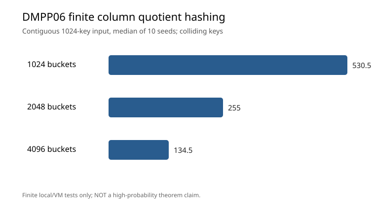

# DMPP06 LATIN 2006 §2.2: finite row-shift/column-permutation quotient hashing

Paper: Demaine, Meyer auf der Heide, Pagh, Pătraşcu, [De Dictionariis Dynamicis Pauco Spatio Utentibus](https://people.csail.mit.edu/mip/papers/dyndict/dyndict.pdf).

**Scope: independent finite-model reproduction of §2.2 Transformations 2 and 3, NOT a complete high-concentration quotient hash family.**

Implementation: 16-bit universe, 256 rows × 256 columns. Transformation 2 applies a per-row circular column shift; Transformation 3 applies an independently seeded odd-modular-affine *bijective* permutation to the row address inside each shifted column. The resulting 16-bit permutation is split into (bucket, quotient) and inverted exactly.

Crucial differences from the proof:
- Per-row shifts are stored in an explicit 256-byte table rather than Siegel's highly independent hash family. Independence and high-probability guarantees in Theorem 5 are **not** obtained.
- Per-column odd-mod-256 affine permutations are invertible finite engineering substitutions, **not** the cited two-universal field-permutation construction. No equivalent probability bounds are claimed.
- Only §2.2's case with bucket count b >= key count n is exercised; the b < n branch, full memory bounds, and other transformations remain outstanding.
- The measured 1,024 metadata bytes are a fixed-universe implementation measurement, **not** DMPP06's asymptotic succinct representation.
- DMPP06's §3 third-level high-performance dictionary is delegated to Dietzfelbinger–Meyer auf der Heide (ICALP 1990); our preexisting std::unordered_map fallback is still a surrogate. Do not present it as that paper's algorithm.

Real protocol: bucket bits 10/11/12, n 512/1024/2048 (only n <= b), two fixed input distributions (contiguous/uniform), ten seeds: 160 real attempts. Every key's (bucket, quotient) map is exact and invertible; collision-key counts are obtained from measured bucket occupancy, not fabricated theoretical values. Full-domain bijectivity verified exhaustively in 48 combinations (8 bucket settings x 6 seeds).

Reproduce:

    c++ -std=c++20 -O2 -Iinclude tests/test_dmpp06_column_quotient.cpp -o /tmp/d22-test
    /tmp/d22-test
    c++ -std=c++20 -O3 -Iinclude src/bench_dmpp06_column_quotient.cpp -o /tmp/d22-bench
    /tmp/d22-bench 10 > /tmp/d22.csv
    python3 scripts/report_dmpp06_column_quotient.py /tmp/d22.csv /tmp/d22-out

The SVG is generated directly from validated observations. These observations cannot be compared as formal L3 or HF-Score measurements.

## Independently verified cloud evidence — v0.22.0

[GitHub Actions run 40838246871](https://github.com/ZJY-HSBL/HashFrontier/actions/runs/40838246871) finished successfully on Ubuntu 24.04, GCC 13.3.0, AMD EPYC 7763 virtual hardware. **160/160 observed rows are complete** across 16 parameter/distribution configurations and 10 seeds. All 12,583,011 full-domain bijection tests and ASan/UBSan passed.

Measured 1024 contiguous keys (10-seed median): bucket count 1024/2048/4096 corresponds to 530.5/255/134.5 keys belonging to buckets with occupancy ≥2. This is a finite observation, not an empirical validation of Theorem 5's tail bound. 16-bit test/permutation inputs and full provenance are preserved.

[Raw](../results/v0.22.0-dmpp06-column/raw.csv) · [Summary](../results/v0.22.0-dmpp06-column/summary.csv) · [Audit](../results/v0.22.0-dmpp06-column/audit.json) · [Source/data SHA-256](../results/v0.22.0-dmpp06-column/sha256.txt)
