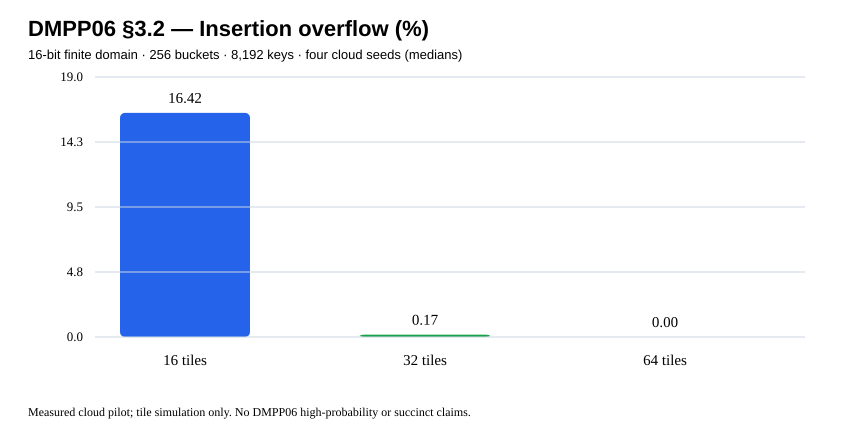
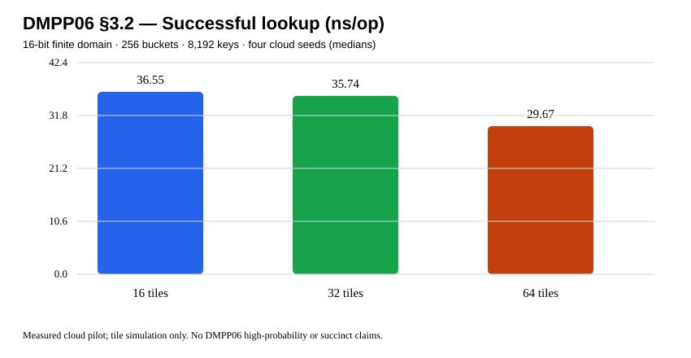

# DMPP06 §3.2 finite multi-filter — actual cloud results (v0.20.0)

Source: Demaine et al., *De Dictionariis Dynamicis Pauco Spatio Utentibus*, LATIN 2006 §3.2, [manuscript](https://people.csail.mit.edu/mip/papers/dyndict/dyndict.pdf). Mechanism scope: permutation at each level; geometric tile halving; offset stored inside selected tile; first vacant tile wins; stable code until deletion; overflow explicitly deferred to the absent third level.

[GitHub Actions 40630812596](https://github.com/ZJY-HSBL/HashFrontier/actions/runs/40630812596) actually compiled and ran 72/72 real runs (two bin sizes × three base tile counts × three attempted-key counts × four seeds) in a single job. Runner: **AMD EPYC 9V74 4 visible vCPU**, Ubuntu 24.04, **GCC 13.3.0**, kernel 6.17.0-1022-azure. Full original [environment](../results/v0.20.0-dmpp06/environment.txt). **298,141 oracle checks**, 62,002 accepted insertions, 20,684 deletions, 1,998 explicit overflows in a separate randomized test; ASan/UBSan and CTest passed.

## Cloud results: 256 buckets, 8,192 insertion attempts

| First-level tiles | Median overflow, 4 seeds | Median hit ns/op | Median insertion ns/attempt |
|---:|---:|---:|---:|
| 16 | 16.418457% | 36.5487 | 57.5995 |
| 32 | 0.170898% | 35.7420 | 57.1765 |
| 64 | 0.000000% | 29.6686 | 54.5378 |

Numbers above come from the archived real [raw CSV](../results/v0.20.0-dmpp06/raw.csv), aggregated in [summary.csv](../results/v0.20.0-dmpp06/summary.csv). Each run verifies successful inserts and misses, then deletes approximately one-quarter of accepted keys, checks stable hashcodes of surviving keys and performs full structural verification. **Rejected inserts are excluded from the successful lookup set.**

Evidence: [strict completeness audit](../results/v0.20.0-dmpp06/audit.json) · [SHA-256](../results/v0.20.0-dmpp06/sha256.txt) · [test log](../results/v0.20.0-dmpp06/tests.log) · [implementation limits](STOC25-DMPP06-SECOND-LEVEL-v0.20.0.md).

**Research limit:** Finite 16-bit, four-level tile mechanism only. Permutations are invertible but not the paper's specified Theorem 5 random family; code does not achieve succinct word-packing or bounded worst-case time. No third-level implementation and no full-paper L2 / L3 / HF-Score claim.
