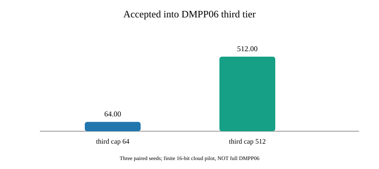
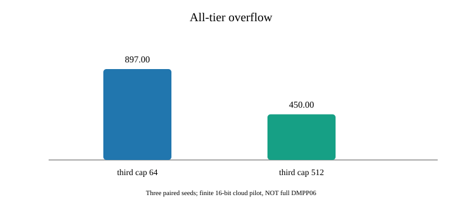

# DMPP06 Section 3 — finite three-tier stable-code dictionary reproduction (v0.21.0)

Original: Demaine, Meyer auf der Heide, Pagh and Pătraşcu, *De Dictionariis Dynamicis Pauco Spatio Utentibus*, LATIN 2006. [Full text](https://people.csail.mit.edu/mip/papers/dyndict/dyndict.pdf).

## Implemented

The finite 16-bit implementation routes each new key to the first accepting filter: §3.1 first-level stable-code quotient bucket, §3.2 second-level shrinking tile filters, then the third-level high-performance dictionary **interface**. It queries the three layers in this order; updates/deletions target the resident layer. Each tier has a disjoint code range, and an assigned code stays unchanged until deletion. The third layer maintains explicitly allocated codes and reclaims them on deletion. Duplicate insertion and full-capacity failures are explicit.

**Important fidelity limitation:** The fallback is instantiated using `std::unordered_map`, *not* the Dietzfelbinger–Meyer auf der Heide dynamic high-performance dictionary cited in the paper. First-/second-tier quotient permutations, per-bucket allocation, and storage are finite engineering approximations; there is no implementation or empirical proof of the original asymptotic `[n+t]` code range, theoretical bit bound, or high-probability O(1) updates. The STOC 2025 Partner Hashing implicit retrieval structure also remains incomplete.

## Verified execution

[GitHub Actions run 40835711365](https://github.com/ZJY-HSBL/HashFrontier/actions/runs/40835711365) successfully ran the randomized differential test, AddressSanitizer/UndefinedBehaviorSanitizer, and the 96-cell cloud matrix. Exact build: Ubuntu 24.04, GCC 13.3, Intel Xeon Platinum 8573C virtual CPU (4 vCPUs).

- 115,200 actual randomized operations, 676,373 oracle checks, 255,374 hashcode stability checks.
- 20,025 admissions to the third tier in the randomized tests; 15,884 all-tier capacity overflows correctly reported without phantom membership.
- 96/96 genuine cloud observations (32 configurations × 3 seeds), all passed strict CSV/operation-count validation.
- Configuration: first and second quotient bucket bits 4/6; first codes 2/4; second tile count 2/4; third tier capacity 64/512. Each case: 1,600 distinct insert attempts, hit/miss queries, updates, erase-all and reinsert-previously-rejected checks.
- [Raw CSV](../results/v0.21.0-dmpp06-three/raw.csv) · [Summary CSV](../results/v0.21.0-dmpp06-three/summary.csv) · [Audit](../results/v0.21.0-dmpp06-three/audit.json) · [Environment](../results/v0.21.0-dmpp06-three/environment.txt) · [SHA-256](../results/v0.21.0-dmpp06-three/sha256.txt).

### Representative measured rows

Fixed parameters first/second bucket bits = 6/6, first bucket codes = 4, second first-level tiles = 4, with three seeds:

| Third tier capacity | Accepted in level 1 | Level 2 | Level 3 | Overall overflows | Build ns/attempt | Hit ns/op |
|---:|---:|---:|---:|---:|---:|---:|
| 64 | 256 | 383 | 64 | 897 | 123.892 | 48.030 |
| 512 | 256 | 382 | 512 | 450 | 130.656 | 52.634 |

Times are medians of three cloud seeds, and each build attempts 1,600 insertions. Acceptance differences reflect the finite capacity model; these experiments are *not* direct validation of DMPP06's high-probability space/time theorem.





## Reproduction

```bash
c++ -std=c++20 -O2 -Iinclude tests/test_dmpp06_three_level.cpp -o /tmp/dmpp06_test
/tmp/dmpp06_test
c++ -std=c++20 -O3 -DNDEBUG -Iinclude src/bench_dmpp06_three_level.cpp -o /tmp/dmpp06_bench
/tmp/dmpp06_bench > /tmp/dmpp06.csv
python3 scripts/report_dmpp06_three_level.py /tmp/dmpp06.csv /tmp/dmpp06_out
```

Final common-hardware HF-Score evaluation remains deferred until all paper implementations are ready.
