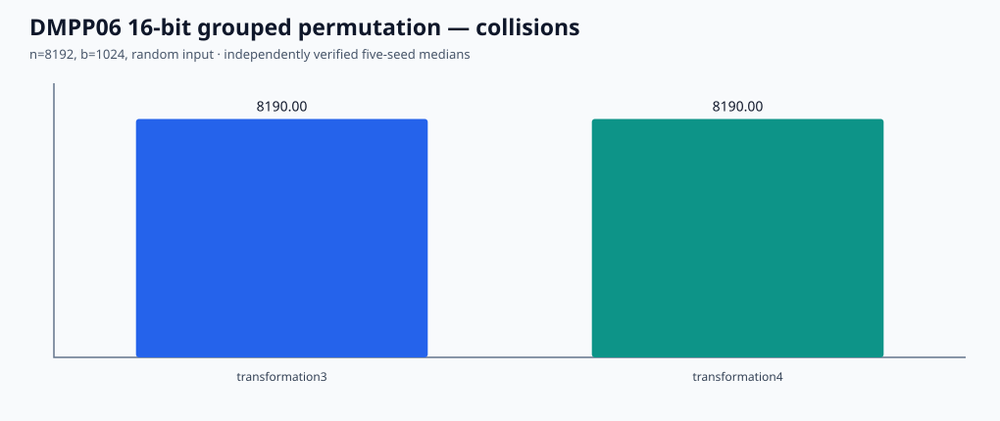
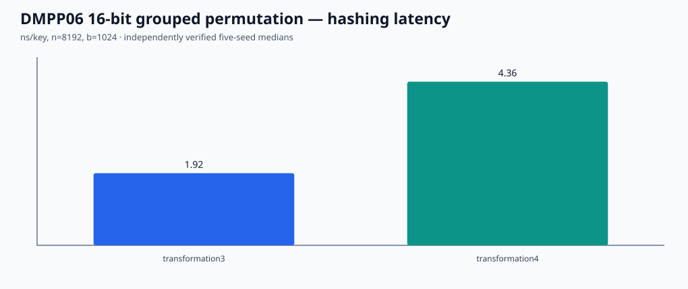

# DMPP06 §2.2 Transformation 4 — finite group-shared permutation verification

Source: Demaine, Meyer auf der Heide, Pagh and Pătraşcu, *De Dictionariis Dynamicis Pauco Spatio Utentibus* (LATIN 2006), §2.2, https://people.csail.mit.edu/mip/papers/dyndict/dyndict.pdf .

The paper's **b < n** branch divides columns into groups, permutes the first-order buckets using a uniformly random permutation *shared by columns in the same group*, then merges first-order buckets into output buckets. In this experiment the **16-bit universe** has 256 columns × 256 positions; each column has 16 first-order tiles × 16 offsets. The 256 columns form 16 groups, each containing 16 columns. Each group samples an independent Fisher–Yates permutation on 16 first-order tile labels, with rejection sampling for unbiased indices. The per-tile residual offset is unchanged, yielding an exactly invertible 16-bit permutation. It is paired with v0.22.0's preexisting finite Transformation-2/3 baseline, and supports bucket bits 9–15.

This finite scaling **does not exactly match** the original asymptotic n^(3/4), n^(1/4), n^(5/4) parameters, or its truly random on-rows Siegel high-independence hash. The baseline uses v0.22's explicit random row shifts and per-column modular permutation, not the v0.23 GF(256) implementation. This is an explicitly bounded reproduction of **Transformation 4's grouped-sharing and reversibility mechanism**, *not* Theorem 5 and *not* a complete DMPP06 / STOC 2025 Partner Hashing implementation. It does not provide any new asymptotic guarantee.

The benchmark tests n=4096/8192/16384, b=512/1024/2048/4096/8192, contiguous versus uniformly shuffled keys, 5 seeds, and identical inputs for Transformation 3/4: 300 actual rows. For **b < n** specifically, select rows with `2^bucket_bits < keys`. We report the complete matrix and its n=8192, b=1024 subset; no cross-machine HF-Score comparison. `collision_keys` counts all keys landing in buckets of load ≥2. `over_threshold_keys` counts keys beyond ceil(1.25*n/b) capacity *after placement*, unlike the number of rejected insertion attempts in the earlier tier benchmarks. The two metrics must not be conflated.

Siegel, *On Universal Classes of Extremely Random Constant-Time Hash Functions* (SIAM J. Comput. 2004, DOI 10.1137/S0097539701386216), describes theoretically high-independence families whose concrete constructions have impractically large constants; an explicit implementation of that source has NOT been supplied here. Future work remains faithful Siegel-family construction / proof-assumption verification and high-performance third-tier dictionary.

## GitHub Actions verified independent cloud results (v0.24.0)

[Cloud execution 40845661999](https://github.com/ZJY-HSBL/HashFrontier/actions/runs/40845661999) completed: 300/300 paired observations, 240 strict b<n observations, 60 summary rows, 5 seeds/configuration. Test, ASan/UBSan, report-audit regression and measured evidence archiving all succeeded. CPU: AMD EPYC 7763 virtual host; OS: Ubuntu 24.04; GCC: 13.3.0.

For **n=8192, b=1024, shuffled/uniform input**, 5-seed medians:

| Method | Keys over 1.25× mean-load threshold | Collision-involved keys | Median hash ns/key | Metadata B |
|---|---:|---:|---:|---:|
| Transformation 3 | 373 | 8,190 | 1.92206 | 1,024 |
| Transformation 4 | 350 | 8,190 | 4.36252 | 1,536 |

The collision-involved key metric saturates near n for load≈8, so it is **not a sensitive indicator** of this parameter's imbalance; consult the over-threshold metric rather than declaring a collision improvement. This is a finite comparison on one cloud machine, without extrapolating to DMPP06's theorem.

[Raw rows](../results/v0.24.0-dmpp06-group/raw.csv) · [summary](../results/v0.24.0-dmpp06-group/summary.csv) · [audit](../results/v0.24.0-dmpp06-group/audit.json) · [environment](../results/v0.24.0-dmpp06-group/environment.txt) · [source+data hashes](../results/v0.24.0-dmpp06-group/sha256.txt).

