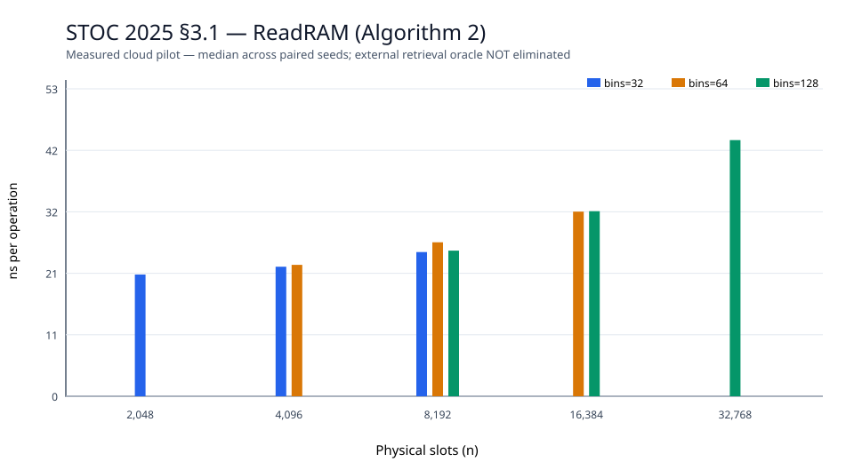
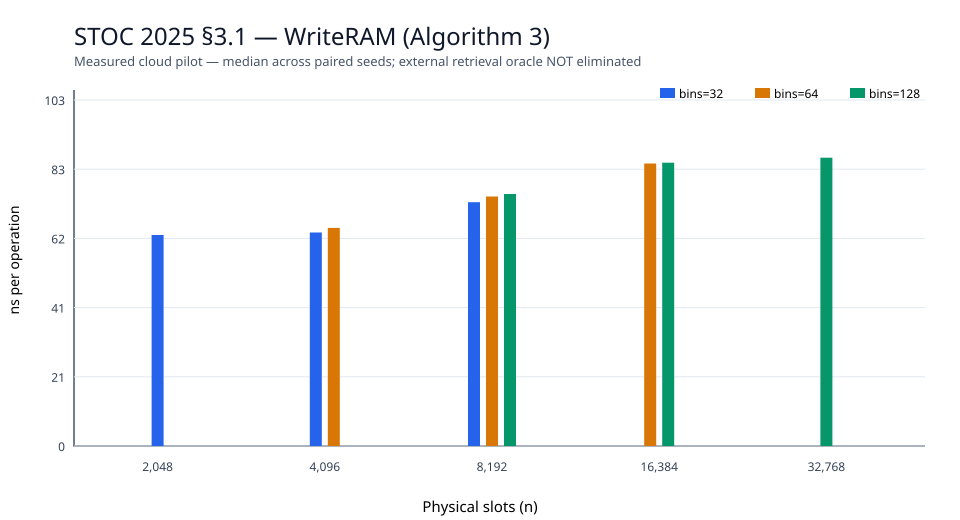

# STOC 2025 — Partner Hashing Section 3.1 cloud evidence (v0.14.0)

Paper: Bender, Kuszmaul & Zhou, *Optimal Non-Oblivious Open Addressing*, STOC 2025; [paper](https://arxiv.org/html/2503.13628), [DOI](https://doi.org/10.1145/3717823.3718215).

**Scope: Algorithm 1–3 isolated partner-pair RAM encoding only; this is NOT complete Partner Hashing.** We implement ReadRAM, WriteRAM and physical-key position recovery using the prescribed index/partner bin swaps and XOR word masks. An external `unordered_map` provides the retrieval oracle; `r_i` masks are also external. Neither is eliminated. No full dictionary insert/delete, §4 backyard/dense-sparse RAM or §5 dynamic resizing. No formal complexity theorem or HF-Score is claimed.

## Real GitHub Actions cloud run

- [Run 40180896046](https://github.com/ZJY-HSBL/HashFrontier/actions/runs/40180896046): **success**. CPU Intel Xeon Platinum 8573C VM, Ubuntu 24.04, GCC 13.3.0.
- Exact C++ test result: `partner_ram_section3 OK checks=136125 accepted=67431 unrepresentable=69`.
- **45/45** runs: 9 (bins, bin_size) combinations × 5 seeds. Each run attempts 12,000 writes and verifies 120,000 reads; 45/45 pass complete data audit. The benchmark's write attempts all succeeded, while the smaller adversarial correctness suite recorded 69 unrepresentable writes and verified atomic failure.
- Read/Write ns/op are measured with `std::chrono::steady_clock`; unmodified cloud Runner values not comparable to paper-author figures. Measured physical bytes cover the key array only; `external_metadata_lower_bound_bytes` excludes allocator overhead.

| Bins | B | Slots | Median ReadRAM (ns/op) | Median WriteRAM (ns/attempt) | Failed write attempts |
|---:|---:|---:|---:|---:|---:|
| 32 | 64 | 2048 | 25.732 | 68.998 | 0 |
| 32 | 128 | 4096 | 28.061 | 69.352 | 0 |
| 32 | 256 | 8192 | 30.471 | 72.968 | 0 |
| 64 | 64 | 4096 | 28.04 | 70.205 | 0 |
| 64 | 128 | 8192 | 30.276 | 72.567 | 0 |
| 64 | 256 | 16384 | 33.626 | 73.733 | 0 |
| 128 | 64 | 8192 | 29.832 | 73.191 | 0 |
| 128 | 128 | 16384 | 33.543 | 74.305 | 0 |
| 128 | 256 | 32768 | 40.732 | 71.207 | 0 |

[Raw 45 samples](../results/stoc25-partner-section3/raw.csv) · [summary](../results/stoc25-partner-section3/summary.csv) · [audit](../results/stoc25-partner-section3/audit.json) · [compiler/CPU](../results/stoc25-partner-section3/environment.txt) · [source and data hashes](../results/stoc25-partner-section3/source-and-data.sha256) · [mechanism and limitations](STOC25-PARTNER-REPRODUCTION.md).

## Next reproduction steps

Reproduce the recursively encoded retrieval (Algorithms 4–5), update/query of §3, then §4's full high-probability construction and §5 incremental resize. No release label implying completed reproduction until all components are implemented and tested.
