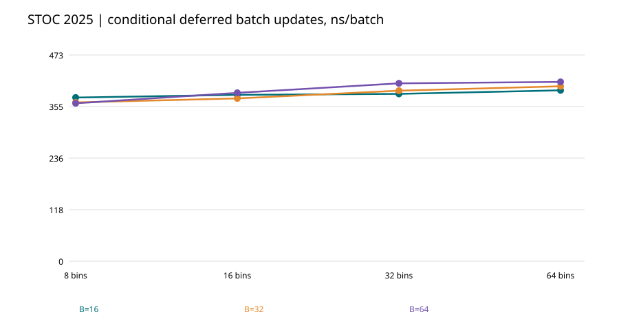
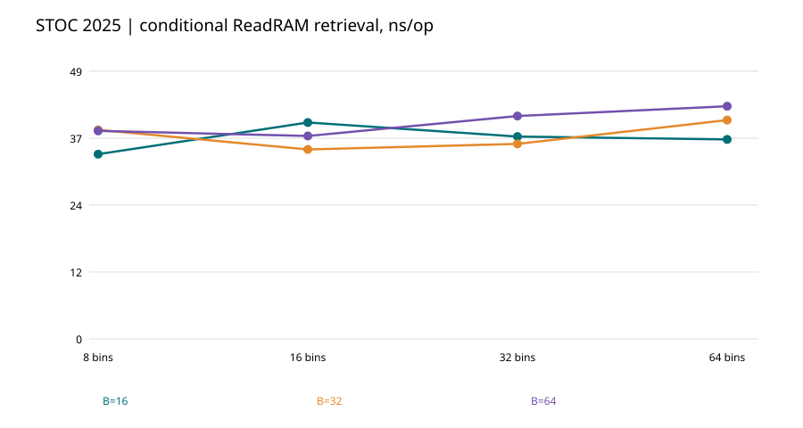

# STOC 2025 Partner Hashing: conditional Algorithm 4–5 cloud experiment (v0.16.0)

**Paper:** Bender, Kuszmaul, Zhou, *Optimal Non-Oblivious Open Addressing*, STOC 2025. [Original text](https://arxiv.org/html/2503.13628).

**Research boundary:** The current test uses an external key-to-RAM-word index and accepts only batches whose planned physical swaps are disjoint. This does not implement the paper's DMPP06-based succinct retrieval structure or its Section 4/5 complete table. No O(1) theorem or full-paper reproduction claimed.

**Source and execution:** [GitHub Actions run 40184160034](https://github.com/ZJY-HSBL/HashFrontier/actions/runs/40184160034), Intel Xeon Platinum 8573C virtual CPU, Ubuntu 24.04, GCC 13.3.0. CMake oracle tests, capacity-exhaustion unchanged-state test, and ASan/UBSan succeeded.

**Actual workload:** 8/16/32/64 bins × B=16/32/64 × five seeds = **60/60 valid rows**. Each row executed 12,000 two-word update attempts and 100,000 verified queries: **720,000 update batches + 6,000,000 queries**. All ordinary update batches committed; a separate overfull-bin adversarial regression confirmed atomic rejection.

## Representative timings (B=32, medians across five seeds, lower is better)

| Bin count | Update ns/batch | Query ns/op |
|---:|---:|---:|
| 8 | 364.08 | 38.05 |
| 16 | 373.24 | 34.49 |
| 32 | 391.01 | 35.50 |
| 64 | 401.08 | 39.83 |

[All raw runs](../results/v0.16.0-partner-retrieval/cloud-raw.csv) · [Full summaries](../results/v0.16.0-partner-retrieval/summary.csv) · [Audit SHA](../results/v0.16.0-partner-retrieval/audit.json) · [Actual environment](../results/v0.16.0-partner-retrieval/environment.txt) · [Checksums](../results/v0.16.0-partner-retrieval/sha256.txt).

**Still missing:** Complete Algorithm 4 dynamic DMPP06 retrieval encoding, general Algorithm 5 dynamic updates, Section 4 fixed-full table and Section 5 resizing. Final same-hardware benchmarking and HF-Score are deferred until the user's final-hardware stage.
