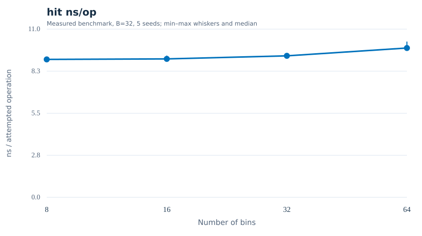
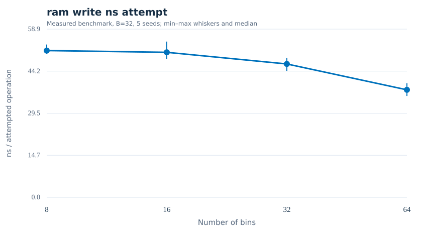
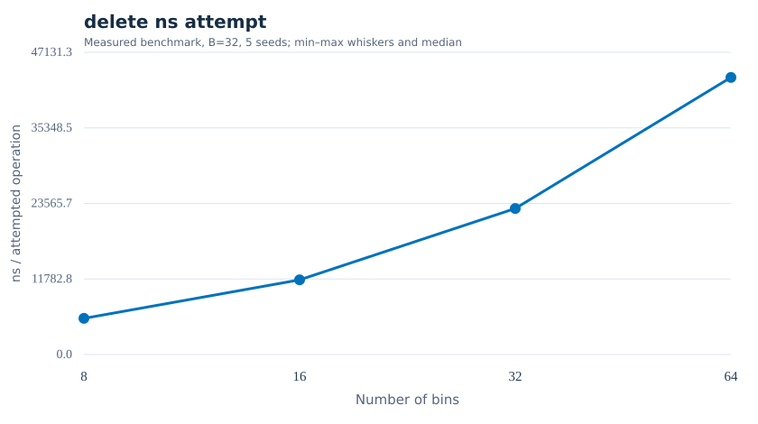

# STOC 2025 Partner Hashing §3.2 / Algorithms 6–8: cloud pilot

**Partial oracle-backed implementation, not full partner hashing.**

Pinned paper: Bender, Kuszmaul, Zhou, [arXiv:2503.13628](https://arxiv.org/abs/2503.13628).

**60/60** measured configurations; 4 bin counts × 3 bin sizes × 5 seeds.

## Actual GitHub Actions timings (B = 32; five-seed median, ns/attempt)

| Bins | Hit | Miss | RAM write | Delete including O(n) rollback snapshot | Insert |
|---:|---:|---:|---:|---:|---:|
| 8 | 9.02 | 10.40 | 51.43 | 5647.12 | 40.26 |
| 16 | 9.06 | 10.70 | 50.83 | 11651.70 | 42.93 |
| 32 | 9.26 | 10.80 | 46.74 | 22774.50 | 45.69 |
| 64 | 9.77 | 10.92 | 37.68 | 43215.80 | 48.35 |

## Scope and important deviations

- Retrieval map, bin counts and random masks remain external: Algorithms 4–5 are **not implemented**.
- Keys are preselected to balance initial bin occupancy; this is a finite-test setup.
- Failed pairing writes are retained in the counts. Delete uses full-copy rollback, so the measured delete time does **not** reflect the paper’s O(1) bound.
- §4 fixed-size strong theorem, §5 resizing and the complete no-metadata table are **not reproduced**.
- These are cloud-VM exploration results, **not HF-Score** or a cross-paper ranking.

[Original rows](../results/stoc25-partner-section3-2/raw.csv) · [Strict summary](../results/stoc25-partner-section3-2/summary.csv) · [Provenance](../results/stoc25-partner-section3-2/audit.json) · [Environment](../results/stoc25-partner-section3-2/environment.txt)
