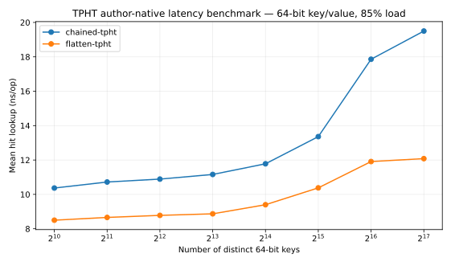
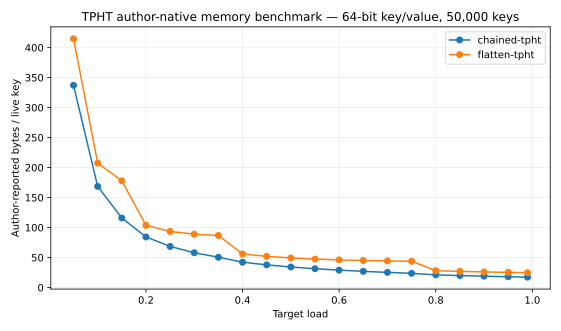

# PVLDB 2026 TPHT: author-native reproduction evidence

**Paper:** Tang, Mai, Kuszmaul, Conway, *Succinct and Fast Tiny Pointer Hash Tables*, PVLDB 19(9), 2026. [DOI](https://doi.org/10.14778/3819518.3819542). Code: [Xilinion/TPHT](https://github.com/Xilinion/TPHT), pinned at `3c39de26faba11bc1a037a1dfd24e3c633ac8987`.

**Reproduction level: original authors' source + native correctness suite + reduced-range original benchmark drivers. This is L2-partial, NOT L2 completion and NOT common-trace L3.**

## Actual CI run / 真正执行记录

[GitHub Actions run 39896663610](https://github.com/ZJY-HSBL/HashFrontier/actions/runs/39896663610) finished successfully. Downloaded and independently inspected [raw artifact](https://github.com/ZJY-HSBL/HashFrontier/actions/runs/39896663610/artifacts/12476848781).

The author's **unchanged C11 code** passed its own original modular exhaustive suites in scalar fallback, portable SIMD, SSE2, AVX2, AVX-512, threaded and `-march=native` modes. ARM NEON was skipped on the x86-64 runner as expected. The native configuration-branch tripwire also reported clean.

The source-provided benchmark scripts actually completed:

```bash
./benchmarks/run_latency.sh 10 17 8 0.85
./benchmarks/run_space_eff.sh 50000
```

The run generated **128 actual latency observations** and **320 actual space observations**, all preserved as CSV and traced to the author's fixed source commit and SHA-256.

## Representative 64-bit key / 64-bit value results

Runner: GitHub Ubuntu 24.04, GCC 13.3, AMD EPYC 9V74 VM. These are native benchmark measurements in the reduced run, *not* the values reported in the paper itself.

**131,072 keys, 85% requested load, latency ns/op**

| Variant | Insert | Hit | Miss | Remove |
|---|---:|---:|---:|---:|
| Chained-TPHT | 22.34 | 19.50 | 16.01 | **31.59** |
| Flattened-TPHT | **14.52** | **12.08** | **11.11** | 34.77 |

**50,000 keys, target load 85%, native allocation report**

| Variant | Allocated bytes | Bytes/key | Payload efficiency |
|---|---:|---:|---:|
| Chained-TPHT | **997,192** | **19.94** | **80.23%** |
| Flattened-TPHT | 1,346,876 | 26.94 | 59.40% |

These are **author-reported internal allocations**, not a separately instrumented cross-paper allocator measurement. Values are not comparable to ZombieHT's allocation method in existing pilots.





[All original driver latency records](../results/v0.9.2-tpht-native-latency.csv) · [space records](../results/v0.9.2-tpht-native-space.csv) · [upstream test log](../results/v0.9.2-tpht-upstream-tests.log) · [SHA / environment / commands](../results/v0.9.2-tpht-provenance.json).

## Remaining requirements for actual L2 / L3

- L2: recover **the paper's exact** plot workloads, key distributions, machine setup, comparisons and range (the above uses a smaller 2^10..2^17 latency sweep and 50k-key space sweep), then rerun and compare numerical or distributional outcomes against the original paper figures. The fixed repository is an industrialized implementation; the [TinyPtr](https://github.com/Xilinion/TinyPtr) paper's separate artifact may be needed for precise figure reproduction.
- L3: all CPU dynamic peers, with full 64-bit key/value, identical pre-generated traces, same actual table load and resize policy, shared allocator accounting, 30 paired seeds, complete update P99 and correct-value oracle. Only then run HF-Score.
- Preserve the **different source commit, hardware and application semantics** of earlier cross-paper v0.7/v0.8 pilots. Never combine their timings with this run into one score.
