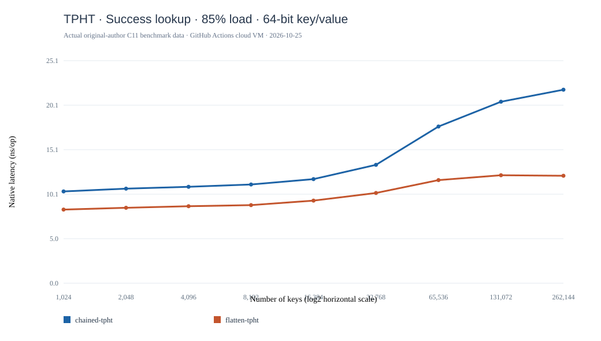
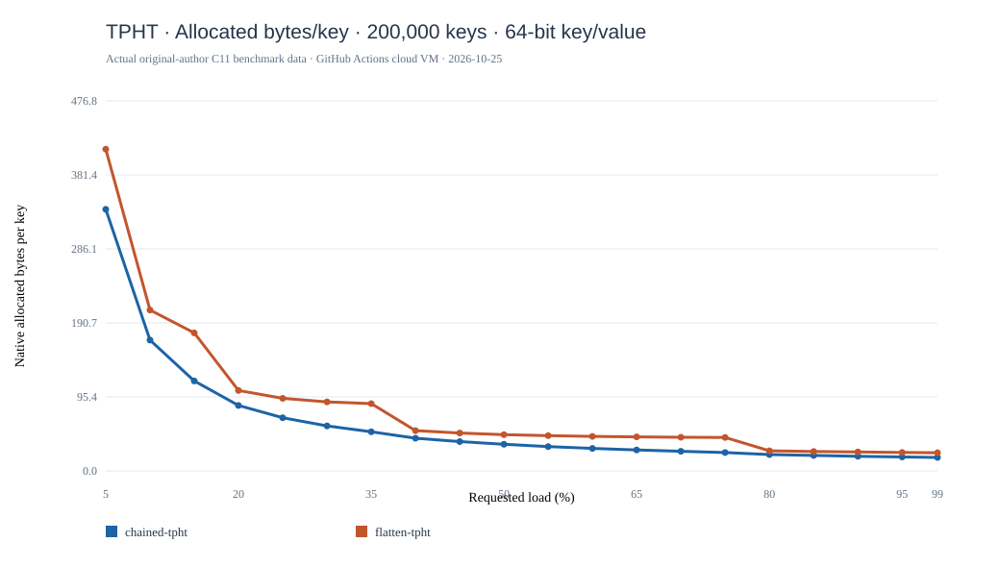

# TPHT · PVLDB 2026 · 官方源码云端多参数复现（v0.13.0）

论文：*Succinct and Fast Tiny Pointer Hash Tables*，DOI [10.14778/3819518.3819542](https://doi.org/10.14778/3819518.3819542)。原作者源码 [Xilinion/TPHT](https://github.com/Xilinion/TPHT)，锁定 commit `3c39de26faba11bc1a037a1dfd24e3c633ac8987`。

**真实原生实验：576 条延迟测量 + 640 条空间测量，完整记录 1216 条。** [GitHub Actions 成功运行](https://github.com/ZJY-HSBL/HashFrontier/actions/runs/40179300855)。作者完整测试脚本成功执行。未修改算法及作者 Benchmark，固定原始版本。所有实验在同一批 GitHub Actions 云端虚拟机上运行。

## 测试矩阵 / Configurations

- 延迟：构造、命中、未命中与删除，32/64-bit Keys；8-byte Values 下的 70%、85%、95% 负载及 1-byte Values 下的 85% 负载；键数 2¹⁰～2¹⁸；Chained / Flattened，合计 576 行。
- 空间：两种规模（100,000、200,000 键）；32/64-bit Keys；1、2、4、8-byte Values；负载 5%～95%（步长 5%）与 99%；Chained / Flattened，合计 640 行。
- 计时采用**作者的 best-of-repetitions**；单位 ns/op。空间为**作者内部 memory_bytes 统计**，并非进程 RSS。与 Zombie Hashing 旧数据不可混合做综合排名。

## 262,144 键，64-bit Key + 64-bit Value

| 负载 | TPHT 变体 | 插入 ns/op | 命中 ns/op | 未命中 ns/op | 删除 ns/op |
|---:|---|---:|---:|---:|---:|
| 70% | chained-tpht | 23.36 | 22.33 | 17.78 | 36.13 |
| 70% | flatten-tpht | 16.20 | 12.78 | 11.02 | 36.27 |
| 85% | chained-tpht | 22.29 | 21.86 | 17.65 | 36.29 |
| 85% | flatten-tpht | 16.33 | 12.14 | 10.66 | 34.93 |
| 95% | chained-tpht | 24.70 | 21.93 | 17.61 | 40.50 |
| 95% | flatten-tpht | 14.51 | 12.71 | 10.81 | 36.28 |

## 内存：200,000 键，85% 负载，64/64-bit

| TPHT 变体 | 原作者报告内存 | Bytes/key |
|---|---:|---:|
| Chained | 3,983,741 bytes | 19.92 |
| Flattened | 5,013,579 bytes | 25.07 |

在本轮参数下，Flattened 的成功查询更快，但 Chained 的空间开销更低。该判断只适用于本轮真实云端测试，不代表所有负载和规模的普遍性能排名。

## 原始图表 / Measured curves

## 可复现证据 / Original evidence

- [作者四个负载 / 值宽延迟 CSV](../results/v0.13.0-tpht/raw/latency-L85-V8.csv)（其他 L70-V8、L95-V8、L85-V1 文件同目录）。
- [100,000 键空间 CSV](../results/v0.13.0-tpht/raw/space-N100000.csv) 与 [200,000 键空间 CSV](../results/v0.13.0-tpht/raw/space-N200000.csv)。
- [运行环境](../results/v0.13.0-tpht/environment.txt) · [作者测试日志](../results/v0.13.0-tpht/upstream-tests.log) · [原始文件校验](../results/v0.13.0-tpht/sha256.txt)。
- [云端运行及工件下载](https://github.com/ZJY-HSBL/HashFrontier/actions/runs/40179300855)。

**本版仍只进行忠实复现与真实云端实验；未来在用户的统一物理设备上重跑全部可比算法后，才进行正式 HF-Score。**
